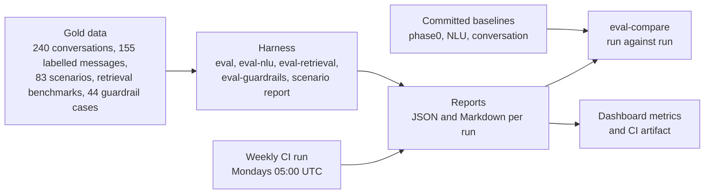

# Ticket-Easy: evaluation and cost report

16 to 17 October 2026. Written for a sales and technical audience that wants to see what is measured, how, and what is still open. Every figure comes from a file under `Docs/output/eval_runs/`; the footnotes at the end of each section name the files. Latency is always "measured on the Groq free tier". Nothing in this report was paid for: every model call used a free tier.

## What the product does, and what we can show

Ticket-Easy answers customers in English, Egyptian Arabic, mixed Arabic-English and Arabizi. Three services do the work: the **conversation service** (understands the message and decides what to do), the **knowledge service** (finds the company policy and enforces its rules) and the **tool service** (connects the shop's own systems as safe tools). The report leads with what a business must trust: answers that cite the policy, rules that are enforced by code, no unsafe actions, Arabic and English coverage, and search quality that is measured.

# Part 1. Evaluation pipeline and results

## 1.1 How the evaluation works

The gold data are fixed files in the repository, so every run answers the same questions. Reports are saved as JSON and Markdown, and a run can be compared with a committed baseline or with another run. A weekly CI workflow runs the conversation evaluation and keeps the report as an artifact; the workflow exists, but this integration branch had not been run in CI before this refresh.[^1]

## 1.2 Headline results

Trust first. These are the results of the agent-mode run on English, Arabic and mixed conversations (180 conversations, 213 messages) with the real knowledge service.

| Item | Result | How it is measured |
|---|---|---|
| Unsafe or unapproved actions in the 240-set run | 0 | wrong_or_unapproved_actions; the run itself saw 0 write requests, so this row alone is not proof (see 1.4) |
| Unsafe actions in the 83 scripted scenarios | 0 failing, 83 of 83 pass | scenarios include real refunds, cancellations, vouchers and exchanges with confirmation |
| Facts in replies that nothing backs | 0 | every sent reply re-checked for numbers, dates, ids and links |
| Guardrail cases | 44 of 44, 0 blocked actions executed | knowledge service guardrail suite |
| Search quality, held-out test split (recall@5) | shop_001 89.29%, noon_eg 97.5%, telco_001 82.22% | 70, 129 and 204 labelled questions, split into dev and test |
| Understanding the customer (intent), English / Arabic / mixed | 95.0% / 95.0% / 93.3% | agent mode, 60 conversations per style |
| Replies that cite the right policy passage | 70.7% | policy-question turns only (75 turns); rules only reach 44.0% |
| Reply in the customer's language | 99.5% | all turns |

Arabizi is measured too and reported in the appendix.[^2]

## 1.3 Knowledge service

**Search quality.** The knowledge service finds the right passage in hybrid mode (local `bge-m3` embeddings plus keywords). Test numbers are on questions that were never used to tune it; dev numbers are shown for reference only.

| Business | Split | Questions | Recall@5 (%) | No-answer precision (%) | No-answer recall (%) | Arabic hits | English hits | Arabizi hits |
|---|---|---|---|---|---|---|---|---|
| shop_001 | test | 37 | 89.29 | 87.5 | 77.78 | 7/9 | 8/9 | 10/10 |
| shop_001 | dev | 33 | 92.59 | 100.0 | 50.0 | 8/9 | 8/9 | 9/9 |
| noon_eg | test | 64 | 97.5 | 93.75 | 62.5 | 12/12 | 16/16 | 11/12 |
| noon_eg | dev | 65 | 90.24 | 90.0 | 75.0 | 11/12 | 15/16 | 11/13 |
| telco_001 | test | 102 | 82.22 | 40.0 | 33.33 | 27/30 | 28/30 | 19/30 |
| telco_001 | dev | 102 | 88.89 | 72.73 | 66.67 | 27/30 | 26/30 | 27/30 |

The weak spot, stated plainly: for questions the documents cannot answer, the service sometimes still returns passages that share words with the question (no-answer recall 33 to 78%). The conversation service therefore checks that a passage really answers the question before it quotes it.

**Guardrails.** 44 of 44 guardrail cases pass and 0 blocked actions were executed. **Noon scenarios:** expected-section recall@5 75.46% (246/326 sections); 45/64 no-evidence cases returned an explicit "no evidence".[^3]

## 1.4 Conversation service: rules alone against agent mode

"Rules only" is the conversation service with no AI model (the starting point). "Agent mode" adds the AI reader, orchestrator, policy answer, writer and reviewer, and every move is still checked by code. Both use the real knowledge service; combined English, Arabic and mixed.

| Measure | Unit | Rules only | Rules only, after one rule fix | Agent mode |
|---|---|---|---|---|
| intent accuracy | % (right/total) | 70.0 (126/180) | 72.2 (130/180) | 94.4 (170/180) |
| decision accuracy | % (right/total) | 75.1 (160/213) | 77.0 (164/213) | 81.7 (174/213) |
| citation accuracy | % (right/total) | 44.0 (33/75) | 49.3 (37/75) | 70.7 (53/75) |
| locale match | % (right/total) | 99.5 (212/213) | 99.5 (212/213) | 99.5 (212/213) |
| handoff precision | % | 81.8 | 100.0 | 65.4 |
| handoff recall | % | 85.7 | 85.7 | 81.0 |
| solved without a person | % (conversations / those needing no person) | 97.5 (155/159) | 100.0 (159/159) | 94.3 (150/159) |
| needless handoffs | count | 4 | 0 | 9 |
| missed escalations | count of those wanted | 3 of 21 | 3 of 21 | 4 of 21 |
| wrong or unapproved actions | count (writes seen in the 240-set run) | 0 (of 0 writes) | 0 (of 0 writes) | 0 (of 0 writes) |
| unbacked facts | count | 1 | 1 | 0 |
| agent fallbacks to the fixed flow | count | 0 | 0 | 0 |
| AI calls per message | calls | 0.0 | 0.0 | 4.85 |
| reply time median, per style (en to mixed range) | seconds, Groq free tier (agent); local (rules) | 0.2 to 0.3 | 0.2 to 0.2 | 5.9 to 7.4 |
| reply time 95th percentile, per style (range) | seconds, Groq free tier (agent); local (rules) | 0.7 to 0.9 | 0.5 to 0.5 | 31.4 to 32.4 |
| sample |  | 180 conversations, 213 turns | 180 conversations, 213 turns | 180 conversations, 213 turns |

What this shows, without spin:

- Agent mode understands the customer far better (intent 70% to 94%) and cites the right policy passage much more often (44% to 71%); decisions improve by about 7 points.
- Agent mode **hands conversations to a person more often than the rules do**: handoff precision is 65% against 82%, with 9 needless handoffs against 4. The one rule fix (a question about support opening hours was being read as a request for a person) lifted the rules-only precision to 100%; the agent runs were made before that fix.
- The agent is slower and uses AI calls: about 4.9 calls per message, median reply 6 to 7 seconds and 95th percentile about 31 seconds on the Groq free tier, which waits when the free plan's per-minute limit is reached. The rules answer in under a second.

**Per language style.**

| Style | Run | Conv. | Intent % | Decision % | Citation % | Language % | Handoff precision % | Handoff recall % | Median s | p95 s |
|---|---|---|---|---|---|---|---|---|---|---|
| en | rules only (before the fix) | 60 | 76.7 | 78.9 | 52.0 | 100.0 | 85.7 | 85.7 | 0.3 | 0.7 |
| en | rules only (after the fix) | 60 | 78.3 | 80.3 | 56.0 | 100.0 | 100.0 | 85.7 | 0.2 | 0.5 |
| en | agent mode | 60 | 95.0 | 80.3 | 68.0 | 100.0 | 66.7 | 85.7 | 7.4 | 31.6 |
| ar | rules only (before the fix) | 60 | 66.7 | 73.2 | 32.0 | 100.0 | 75.0 | 85.7 | 0.3 | 0.9 |
| ar | rules only (after the fix) | 60 | 70.0 | 76.1 | 40.0 | 100.0 | 100.0 | 85.7 | 0.2 | 0.5 |
| ar | agent mode | 60 | 95.0 | 84.5 | 76.0 | 100.0 | 60.0 | 85.7 | 7.2 | 31.4 |
| mixed | rules only (before the fix) | 60 | 66.7 | 73.2 | 48.0 | 98.6 | 85.7 | 85.7 | 0.2 | 0.8 |
| mixed | rules only (after the fix) | 60 | 68.3 | 74.6 | 52.0 | 98.6 | 100.0 | 85.7 | 0.2 | 0.5 |
| mixed | agent mode | 60 | 93.3 | 80.3 | 68.0 | 98.6 | 71.4 | 71.4 | 5.9 | 32.4 |

**Safety, run by run.** The safety counters must stay at zero; here is every run.

| Run | Conversations | Wrong or unapproved actions | Writes seen | Unbacked facts | Note |
|---|---|---|---|---|---|
| rules only, keyword stand-in search | 180 | 0 | 0 | 0 |  |
| rules only, real knowledge service (before the fix) | 180 | 0 | 0 | 1 | the 1 unbacked fact was a passage the real service returned and the evaluation did not know; fixed in the check |
| rules only, real knowledge service (after the fix) | 180 | 0 | 0 | 1 | the same single case as before the fix; the evaluation check was corrected afterwards |
| agent mode, keyword stand-in (first run) | 180 | 0 | 0 | 8 | the 8 unbacked facts were 'today' in greetings; the evaluation check flagged them wrongly and was fixed |
| agent mode, real knowledge service (headline) | 180 | 0 | 0 | 0 |  |
| long conversations, agent mode, real knowledge service | 24 | not scored by the harness; checked by hand: 0 unexpected writes | 8 | 0 | order-data leaks after a failed identity check: 0; returns executed after a topic change: 0; writes executed = turns that carried out a refund, cancel, voucher or exchange |

"Keyword stand-in search" is the simple keyword search the tests used before the real knowledge service was connected.

In the 240-conversation set almost every conversation is one question and one answer (284 messages in 240 conversations), so no write was attempted and "0 of 0 writes" says little by itself. The evidence for write safety is the 83 scripted scenarios (real confirmations and executions) and a set of 24 longer conversations of 5 to 7 messages: there, cancellations, vouchers and exchanges were carried out after a confirmation, no order data leaked after a failed identity check, and no return was executed after the customer changed topic.[^4]

## 1.5 Tool service

The tool service is judged by what it lets a business publish, not by chat accuracy. Its latest recorded end-to-end run (9 October 2026) went from an 81-operation shop API to tested, reviewable tools without help, with the search for operations widening automatically (3 rounds in the hardest request), enforcement reviewed by a person, and sandbox tests gating publication; its suite then had 595 tests and now has 718 passing (1 skipped). In this refresh it also generated a tool from an example e-commerce API on the Groq free tier in 4 seconds with one model call (5,375 tokens).[^5]

## 1.6 How results are shared

- Fixed gold data and committed baselines, so any run is comparable with an earlier one (`eval-compare`).
- Every run writes a JSON and a Markdown report; the weekly CI run keeps the report as an artifact.
- The dashboard shows live metrics (automation rate, escalations by reason, time to first reply and others) per business; the definitions are written down.[^6]

## 1.7 Honest gaps against the targets

| Measure | Target | Agent mode now | Status |
|---|---|---|---|
| Request right (intent) | 90% | 94.4% | target met |
| Outcome right (decision) | 92% | 81.7% | below target |
| Correct source (citation) | 95% | 70.7% | below target |
| Reply language | 100% | 99.5% | almost |

The gap is concentrated in policy questions. On the policy topics the agent often understands the question and then asks a clarifying question or hands over instead of searching and quoting; the fixed flow often answers these correctly. This is the roadmap: a better orchestrator model (Part 2 shows the first evidence) and a rule that policy questions are searched before anything else is asked. A second open item: in agent mode, a refund request on an old order can loop on "what amount?" instead of explaining the 14-day rule.[^7]

---

[^1]: `.github/workflows/eval.yml`, `team_b/eval/baseline_phase0.json`, `team_b/eval/nlu_baseline.json`, `Docs/output/eval_runs/E0_health_check.md`.
[^2]: `Docs/output/eval_runs/tables/per_style.csv`.
[^3]: `Docs/output/eval_runs/knowledge/summary.json` and the command outputs in the same folder; recorded at commit `0be10fd`.
[^4]: `tables/headline.csv`, `tables/per_style.csv`, `tables/safety.csv`, `conversation/compare_agent_vs_rules_live.txt`, `reports/eval_presentation_agent_live_*_2026-10-17.json`, `reports/eval_live_rules_*.json`, `diagnosis/longlive_*.jsonl`, `conversation/scenarios.txt`, `conversation/README_E4_followup.md`.
[^5]: `team_c/E2E_FINAL_REPORT.md`, `knowledge/onboarding_tools_live_smoke.txt`, `usage/onboarding_tools.jsonl`, `conversation/../E0_health_check.md`.
[^6]: `team_b/docs/metrics.md`, `.github/workflows/eval.yml`.
[^7]: `team_b/docs/launch_readiness.md` (targets), `tables/headline.csv`, `diagnosis/live_en_policy.jsonl`, `conversation/README_E4_followup.md`.

# Part 2. Models and cost

## 2.1 The recommended bare-minimum model stack

The aim: the fewest models that still cover every job. **Two chat model slots (one small for high-volume work, one strong for decisions) plus one local embedding model.** Today we also keep Qwen 27B for knowledge and writing, because it words Arabic and Egyptian Arabic replies well (a preview model on Groq that can be withdrawn, so gpt-oss-20b is its automatic backup).

| Job | How often | Model slot |
|---|---|---|
| reader (understand the message) | every message | small |
| writer (word the reply) | every message | small |
| summary (handoff briefing) | handoffs only | small |
| knowledge (answer from policy passages) | policy questions | strong |
| orchestrator (plan, pick moves) | every message in agent mode | strong |
| reviewer (stricter-only check) | every written reply and write | strong |
| tool generation, rule extraction | once per business | strong |
| search embeddings | every search | bge-m3, local ($0 API) |
| Egyptian-Arabic writer (Nile-Chat), judge | optional / tests only | dropped from the minimum stack |

**What the minimum stack costs per 1,000 customer messages** (agent mode, the tokens measured in this refresh; paid list prices; the actual spend so far is $0):

| Option | USD per 1,000 messages | USD per month at 10,000 messages | USD per month at 100,000 messages | Status |
|---|---|---|---|---|
| Today: three Groq models (measured tokens, priced at list) | 2.31 | 23.14 | 231.37 | tokens measured |
| Best value: GPT-6 Luna + Gemini 3.8 Flash (introductory price to 31 Dec 2026) | 6.25 | 62.47 | 624.71 | hypothetical, not tested |
| Best value after 1 Jan 2027 | 12.19 | 121.9 | 1219.02 | hypothetical, not tested |
| Lowest cost: Mistral Small 4 + Mistral Large 3 (prices indicative) | 4.13 | 41.26 | 412.55 | hypothetical, not tested |
| Fully local, L1 starter (one 24-32 GB GPU workstation) | 14.1 to 18.27 at 10k a month | 141.02 to 182.69 | 141.02 to 182.69 (one box, throughput not measured) | estimate: hardware and power |
| Fully local, L2 mirror of today (one 96 GB workstation GPU) | 33.62 to 39.17 at 10k a month | 336.18 to 391.73 | 336.18 to 391.73 (one box, throughput not measured) | estimate: hardware and power |
| Fully local, L3 server (one 80 GB data-centre GPU server) | 92.09 to 119.87 at 10k a month | 920.93 to 1198.71 | 920.93 to 1198.71 (one box, throughput not measured) | estimate: hardware and power |
| Fully local, L3 rented (same GPU by the hour) | 146.0 to 219.0 at 10k a month | 1460.0 to 2190.0 | 1460.0 to 2190.0 (one box, throughput not measured) | estimate: hardware and power |

Local rows are **estimates** (hardware price / 36 months + power x 730 hours x $0.10 per kWh, or 730 rented GPU hours); the API cost is $0 but throughput was not measured, so one box is only assumed to keep up at 10,000 messages a month.[^8]

## 2.2 What was measured about the models

**Understanding the message (the reader job), 155 labelled messages, same prompt, temperature 0, no backup model.** Only this job's model was changed.

| Model | Intent accuracy % | English % | Arabic % | Mixed % | Arabizi % | Latency p50 / p95 ms (Groq free tier) | Tokens per call in / out |
|---|---|---|---|---|---|---|---|
| qwen/qwen3.8-27b | 98.1 | 100.0 | 100.0 | 100.0 | 94.8 | 620 / 851 | 1284.3 / 127.1 |
| openai/gpt-oss-120b | 97.4 | 100.0 | 100.0 | 93.1 | 96.6 | 751 / 1073 | 1572.1 / 119.8 |
| openai/gpt-oss-20b | 96.1 | 100.0 | 100.0 | 89.7 | 94.8 | 627 / 866 | 1314.4 / 116.0 |
| rule-based reader | 87.7 | 91.4 | 84.8 | 82.8 | 89.7 |  |  |

Read this carefully: it tests **one job** (the reader) on **short, hand-written messages**; the three AI readers are within 3 messages of 155 of each other, so they are effectively tied, and all beat the rules by 8 to 10 points. It says nothing about the other jobs. The gpt-oss-120b figure includes 67 messages that had to be re-run on another free account after its daily token limit was reached (the rate-limited calls in the file are from that first pass).[^9]

**The orchestrator (the job that plans each step), English policy and refund conversations: 25 conversations, 27 messages, real knowledge service.** Only the orchestrator model changed.

| Run | Messages | Fallbacks to the fixed flow | Citations right, all messages | Citations right, agent's own messages only | Messages with a failed check |
|---|---|---|---|---|---|
| qwen3.8-27b run 1 | 27 | 0 | 22/25 | 22/25 | 5 |
| qwen3.8-27b run 2 | 27 | 18 | 21/25 | 7/9 | 4 |
| qwen3.8-27b run 3 | 27 | 3 | 21/25 | 20/23 | 5 |
| gpt-oss-20b run 1 | 27 | 1 | 19/25 | 18/24 | 6 |
| gpt-oss-120b run 1 (baseline) | 27 | 0 | 17/25 | 17/25 | 8 |

qwen3.8-27b as orchestrator was repeated three times; the two runs with few fallbacks agree (22 and 21 of 25 citations right) and the run with 18 fallbacks (rate limits) is shown but not relied on. gpt-oss-120b, the orchestrator used today, scored 17 of 25 in one run, and gpt-oss-20b 19 of 25. That is a hint that qwen is the better orchestrator for English policy questions, **not yet a verdict**: it is one language, 25 policy messages, and the 120B repeats are still pending its daily token quota. The original choice of 120B was not based on a head-to-head test.

Arabic and mixed (same design):

| Language | Orchestrator | Citations right, all | Citations right, agent's own messages | Fallbacks | Failed checks | Status |
|---|---|---|---|---|---|---|
| ar | qwen/qwen3.8-27b | 20/25 | 8/11 | 16 | 5 | 16 of 27 turns fell back to the fixed flow (rate limits): read the agent-turns-only column |
| ar | openai/gpt-oss-20b | 15/25 | 14/24 | 1 | 10 | 1 of 27 turns fell back to the fixed flow (rate limits): read the agent-turns-only column |
| ar | openai/gpt-oss-120b |  |  |  |  | pending: not run yet (daily token quota of this model) |
| mixed | qwen/qwen3.8-27b | 19/25 | 3/4 | 23 | 6 | 23 of 27 turns fell back to the fixed flow (rate limits): read the agent-turns-only column |
| mixed | openai/gpt-oss-20b | 16/25 | 16/25 | 0 | 9 | complete |
| mixed | openai/gpt-oss-120b |  |  |  |  | pending: not run yet (daily token quota of this model) |

The qwen runs in Arabic and mixed are **not conclusive**: most messages fell back to the fixed flow because qwen's free daily quota ran out. gpt-oss-20b ran cleanly and is weaker in Arabic and mixed than in English. The 120B runs for these languages are pending.[^10]

**The other jobs, by replaying the same recorded inputs to other models.** Agreement is with the baseline model, not with a ground truth; the writer's wording needs a person (a blinded grading sheet is provided).

*English*

| Job | Model | Inputs | Answered | Failed (e.g. rate limit) | Grounded % | Agrees with baseline % | Looser than baseline | Same passages % | Tokens per call |
|---|---|---|---|---|---|---|---|---|---|
| knowledge | openai/gpt-oss-120b | 22 | 22 | 0 | 100.0 | 100.0 |  | 81.8 | 1055 |
| knowledge | openai/gpt-oss-20b | 22 | 22 | 0 | 100.0 | 100.0 |  | 68.2 | 1050 |
| knowledge (baseline) | qwen/qwen3.8-27b | 22 | 22 | 0 | 100.0 | 100.0 |  | 100.0 |  |
| reviewer (baseline) | openai/gpt-oss-120b | 29 | 29 | 0 |  | 100.0 | 0 |  |  |
| reviewer | openai/gpt-oss-20b | 29 | 29 | 0 |  | 93.1 | 0 |  | 1188 |
| reviewer | qwen/qwen3.8-27b | 29 | 29 | 0 |  | 89.7 | 0 |  | 1089 |
| writer | openai/gpt-oss-120b | 15 | 15 | 0 | 93.3 |  |  |  | 796 |
| writer | openai/gpt-oss-20b | 15 | 15 | 0 | 93.3 |  |  |  | 772 |
| writer (baseline) | qwen/qwen3.8-27b | 15 | 15 | 0 | 100.0 |  |  |  |  |

*Arabic*

| Job | Model | Inputs | Answered | Failed (e.g. rate limit) | Grounded % | Agrees with baseline % | Looser than baseline | Same passages % | Tokens per call |
|---|---|---|---|---|---|---|---|---|---|
| knowledge | openai/gpt-oss-120b | 35 | 32 | 3 | 88.6 | 100.0 |  | 90.6 | 978 |
| knowledge | openai/gpt-oss-20b | 35 | 35 | 0 | 100.0 | 100.0 |  | 82.9 | 971 |
| knowledge (baseline) | qwen/qwen3.8-27b | 35 | 35 | 0 | 100.0 | 100.0 |  | 100.0 |  |
| reviewer (baseline) | openai/gpt-oss-120b | 26 | 26 | 0 |  | 100.0 | 0 |  |  |
| reviewer | openai/gpt-oss-20b | 26 | 26 | 0 |  | 96.2 | 1 |  | 1198 |
| reviewer | qwen/qwen3.8-27b | 26 | 5 | 21 |  | 100.0 | 0 |  | 1064 |
| writer | openai/gpt-oss-120b | 12 | 12 | 0 | 100.0 |  |  |  | 824 |
| writer | openai/gpt-oss-20b | 12 | 12 | 0 | 100.0 |  |  |  | 777 |
| writer (baseline) | qwen/qwen3.8-27b | 12 | 12 | 0 | 100.0 |  |  |  |  |

*Mixed*

| Job | Model | Inputs | Answered | Failed (e.g. rate limit) | Grounded % | Agrees with baseline % | Looser than baseline | Same passages % | Tokens per call |
|---|---|---|---|---|---|---|---|---|---|
| knowledge | openai/gpt-oss-120b | 36 | 36 | 0 | 97.2 | 100.0 |  | 88.9 | 940 |
| knowledge | openai/gpt-oss-20b | 36 | 36 | 0 | 100.0 | 100.0 |  | 94.4 | 926 |
| knowledge (baseline) | qwen/qwen3.8-27b | 36 | 36 | 0 | 100.0 | 100.0 |  | 100.0 |  |
| reviewer (baseline) | openai/gpt-oss-120b | 25 | 25 | 0 |  | 100.0 | 0 |  |  |
| reviewer | openai/gpt-oss-20b | 25 | 25 | 0 |  | 96.0 | 1 |  | 1188 |
| reviewer | qwen/qwen3.8-27b | 25 | 3 | 22 |  | 100.0 | 0 |  | 1058 |
| writer | openai/gpt-oss-120b | 11 | 11 | 0 | 100.0 |  |  |  | 801 |
| writer | openai/gpt-oss-20b | 11 | 11 | 0 | 100.0 |  |  |  | 776 |
| writer (baseline) | qwen/qwen3.8-27b | 11 | 11 | 0 | 100.0 |  |  |  |  |

**Reviewer, the safety-relevant job:** an alternative reviewer was more lenient than the baseline on 1 input(s) for openai/gpt-oss-20b in ar; 1 input(s) for openai/gpt-oss-20b in mixed, so a cheaper reviewer is not yet shown to be as strict; it needs a larger test before it is used.
Failed replays are rate limits (qwen's free daily quota ran out), not wrong answers; a row with many failures is not a result.[^11]

## 2.3 The models, measured against hypothetical

| Model | Deploy | Role | Status | Latency | Quality fit | USD per 1M tokens in / out |
|---|---|---|---|---|---|---|
| Groq gpt-oss-20b | cloud (Groq free tier) | reader candidate, summary, judge, backup of the qwen jobs | measured in this refresh | reader p50 627 ms, p95 866 ms (Groq free tier) | reader intent accuracy 96.1% on 155 messages; orchestrator test (English only): 19 of 25 policy citations; reviewer replays agree 93% with the baseline | 0.075 / 0.3 |
| Groq qwen3.8-27b | cloud (Groq free tier, preview model) | reader, knowledge, writer, summary (today) | measured in this refresh | reader p50 620 ms, p95 851 ms (Groq free tier) | reader intent accuracy 98.1% (best of the three); as orchestrator on English policy conversations: 22 of 25 and 21 of 25 citations (two clean runs) | 0.8 / 4.0 |
| Groq gpt-oss-120b | cloud (Groq free tier) | orchestrator, reviewer (today) | measured in this refresh | reader p50 751 ms, p95 1073 ms; agent turn median 6 to 7 s (Groq free tier) | reader intent accuracy 97.4%; orchestrator on English policy conversations: 17 of 25 citations (one run; repeats and Arabic/mixed pending its daily token quota) | 0.15 / 0.6 |
| Ollama bge-m3 | local | knowledge service search and document embeddings | in use, local, measured | query p50 103 ms, p95 142 ms | retrieval recall@5 on the held-out test split: shop_001 89.3%, noon_eg 97.5%, telco_001 82.2% | 0 (local) |
| OpenRouter free: Nemotron 3 Super 120B (and Gemma 4 31B as the second choice) | cloud (OpenRouter free) | knowledge service: rule extraction and risk second opinion | in use, measured (not benchmarked) | rule extraction p50 6832 ms; risk check p50 2136 ms | 36 passages produced 20 candidate rules; all 40 risk checks answered; quality of the rules was not judged | free; paid version 0.08 / 0.45 |

Models that were not run in this refresh appear only in the cost tables below, marked **hypothetical, not tested**; their latency and quality are "not tested". We do not recommend a top-tier model as the default volume stack.

## 2.4 What it would cost with other models (hypothetical, not tested)

The same measured tokens per job, priced for other vendors' models. **None of these models was run.** Two caveats: other models count the same text as more or fewer tokens, and their quality and speed are unknown until they are actually run.

| Stack | USD per 1,000 messages | USD per month at 10k | USD per month at 100k | Status | Quality / speed |
|---|---|---|---|---|---|
| bare-minimum, today: reader+summary gpt-oss-20b, knowledge+writer qwen3.8-27b, orchestrator+reviewer gpt-oss-120b (plan slots) | 2.314 | 23.14 | 231.37 | measured tokens x list price | see models.csv |
| bare-minimum, best value (recommended in the plan): small GPT-6 Luna, strong Gemini 3.8 Flash (to 31 Dec 2026) | 6.247 | 62.47 | 624.71 | hypothetical, not tested | not tested |
| bare-minimum, best value: same, Gemini 3.8 Flash from 1 Jan 2027 | 12.19 | 121.9 | 1219.02 | hypothetical, not tested | not tested |
| bare-minimum, lowest cost: small Mistral Small 4, strong Mistral Large 3 | 4.126 | 41.26 | 412.55 | hypothetical, not tested | not tested |
| what-if 1a: GPT-6 Luna for every job | 1.096 | 10.96 | 109.65 | hypothetical, not tested | not tested |
| what-if 1b: Gemini 3.5 Flash-Lite for every job | 3.74 | 37.4 | 373.97 | hypothetical, not tested | not tested |
| what-if 2a: GPT-6.1 Sol orchestrator and reviewer, GPT-6 Luna for the rest | 15.4 | 154.0 | 1540.0 | hypothetical, not tested | not tested |
| what-if 2b: Claude Sonnet 5.5 orchestrator and reviewer, GPT-6 Luna for the rest | 15.4 | 154.0 | 1540.0 | hypothetical, not tested | not tested |
| what-if 3a: DeepSeek Flash for every job (peak price) | 3.154 | 31.54 | 315.44 | hypothetical, not tested | not tested |
| what-if 3b: DeepSeek Flash for every job (off-peak price) | 1.577 | 15.77 | 157.72 | hypothetical, not tested | not tested |
| what-if 3c: Mistral Small 4 for every job | 1.577 | 15.77 | 157.72 | hypothetical, not tested | not tested |

## 2.5 Tokens measured

Every figure below is a count the provider returned, written to a usage log by the three services in one shared format. Usage before the log existed was not recorded; the totals are for the runs of this refresh, with their dates (UTC).

| Service | Logged calls (all attempts) | Tokens measured | First to last call (UTC) |
|---|---|---|---|
| conversation service | 14,742 | 11,941,949 | 2026-10-16T20:06 to 2026-10-17T00:41 |
| knowledge service | 905 | 283,235 | 2026-10-16T19:56 to 2026-10-17T00:31 |
| tool service | 1 | 5,375 | 2026-10-16T23:32 to 2026-10-16T23:32 |
| all services | 15,648 | 12,230,559 |  |

**Tokens per conversation, by job (agent mode, English + Arabic + mixed, 180 conversations, 213 messages).**

| Job | AI calls per message | Tokens per message | Tokens per conversation |
|---|---|---|---|
| knowledge | 0.3 | 294 | 348 |
| orchestrator | 1.41 | 5517 | 6528 |
| reader | 1.0 | 1431 | 1693 |
| reviewer | 0.9 | 1054 | 1247 |
| summary | 0.12 | 97 | 115 |
| writer | 1.12 | 771 | 912 |
| ALL PRODUCTION JOBS (without the judge) | 4.85 | 9164 | 10844 |

**All components together, per conversation.**

| Component | Tokens per conversation | Status | Basis |
|---|---|---|---|
| conversation service (AI jobs, measured) | 10844 | measured | usage/agent_live_*.jsonl, 180 conversations |
| knowledge service: search embeddings (local bge-m3) | 6.6 | estimate (window count) | 66 query embeddings in the time window of the three agent runs / 180 conversations x 17.9 tokens each; the 15-conversation Arabizi sample ran in the same window |
| knowledge service: risk second opinion (OpenRouter free) | 414.9 | estimate | 1.18 messages per conversation x 350.6 tokens per check (measured on 40 messages); the evaluation ran with this second opinion switched off, so this is the cost if it is switched on |
| TOTAL per conversation (all components) | 11265.5 | contains estimates | sum of the rows above |

The conversation tests use the real knowledge service for search, but its AI risk second opinion was switched off during them; that row is therefore an estimate of the cost if it is switched on.[^12]

## 2.6 Cost tables

Actual spend so far: **$0**. Every other number is what the same measured tokens would cost at paid list prices.

| Stack | USD per 1,000 messages | USD per month at 10k | USD per month at 100k | Pilot: 50,000 messages + 2 onboardings (USD) | Status |
|---|---|---|---|---|---|
| rules + local embeddings (no AI model) | 0.0 | 0.0 | 0.0 | 0.0 | measured tokens x list price |
| agent mode, today's free Groq mix (measured) | 3.843 | 38.43 | 384.26 | 192.18 | measured tokens x list price |
| agent mode, qwen3.8-27b as orchestrator too | 9.973 | 99.73 | 997.3 | 498.68 | estimate |

The conversation service accounts for all of the AI cost in these rows; the knowledge service's search runs on a local model ($0 API) and its risk second opinion runs on a free model. Qwen as the orchestrator looks expensive at Groq's list price for qwen ($0.80 in / $4.00 out per million tokens, a preview model): about 2.6 times today's mix, because it also uses more tokens per message. At OpenRouter's lower price for the same model family the picture would differ, so the choice of orchestrator should be made on quality first and then priced on the provider actually used.

**One business onboarding, measured.**

| Step | Tokens | Counts |
|---|---|---|
| tool generation (tool service, Groq free tier) | 5375 | reported by the server |
| rule extraction (knowledge service, OpenRouter free) | 79382 | reported by the server |
| document embeddings (knowledge service, local bge-m3) | 3384 | reported by the server |
| ONE ONBOARDING, all steps | 88141 | reported by the servers |

| Step | Model | Input tokens | Output tokens | List price (USD) | Status |
|---|---|---|---|---|---|
| tool generation (tool service) | groq/gpt-oss-120b | 3980 | 1395 | 0.00143 | measured tokens x list price |
| rule extraction (knowledge service) | openrouter/nemotron-3-super-120b-a12b (paid) | 59986 | 19396 | 0.01353 | measured tokens x list price |
| document embeddings (knowledge service) | bge-m3 on local Ollama | 3384 | 0 | 0.0 | measured; $0 API |
| ONE ONBOARDING |  | 67350 | 20791 | 0.01496 | the example API has only 2 operations, so the tool-generation part is small; a real business costs more |

Onboarding costs cents at list price and was measured on one example API with only 2 operations; a real business with many operations uses more tool-generation tokens. The quality of the generated tool and of the 20 candidate rules was not judged in this refresh.[^13]

## 2.7 Onboarding on other models

**Tool generation (tool service, Groq free tier).** The tool service demands output in a strict structure. Each model got the same example e-commerce API (2 operations) and the same prompt; each attempt is one request, as in the product.

| Model | Attempts | Accepted | Tokens of an accepted run | Tool proposed |
|---|---|---|---|---|
| gpt-oss-120b | 2 | 2 | 5375 | Order Lookup & Support Ticket Creator; Order Lookup and Support Ticket Creator |
| qwen3.8-27b | 3 | 1 | 4262 | Order Support Ticket |
| gpt-oss-20b | 3 | 0 |  |  |

Only gpt-oss-120b produced a valid tool every time. qwen3.8-27b produced one in three attempts and gpt-oss-20b in none: Groq rejected their output as invalid or not matching the required structure. This is a reason to keep the strong model for onboarding even if the cheaper models handle the chat. It is a small test (one example API, three attempts); no model other than the three Groq models was tried, and the local models were not tested.[^14]

**Rule extraction (knowledge service, free OpenRouter models).** The same 36 policy passages of the example shop were sent to each model; nothing was stored or approved, and the candidate rules were not judged for quality.

| Model | Passages | Passages that failed | Candidate rules | Answered requests | Failed or rate-limited | Input tokens | Output tokens | Median latency ms |
|---|---|---|---|---|---|---|---|---|
| nvidia/nemotron-3-super-120b-a12b:free (measured first) | 36 | 0 | 20 | 36 | 0 | 59986 | 19396 | 9626 |
| nvidia/nemotron-3-ultra-550b-a55b:free |  | could not complete |  | 7 | 0 | 0 | 0 | 548 |
| google/gemma-4-26b-a4b-it:free |  | could not complete |  | 0 | 7 | 0 | 0 |  |

Of the three free models tried, only Nemotron 3 Super gave usable answers. Nemotron 3 Ultra answered every request without a usable body and Gemma 26B was refused with HTTP 429 (Gemma 31B had been refused too in the first measurement), so the free route for rule extraction depends on one model and needs a fallback; the knowledge service tries models in turn but the free choices are fragile.[^14]

---

[^8]: `tables/hypothetical.csv`, `tables/local_estimates.csv`, `tables/cost_notes.md`, `tables/prices.csv`.
[^9]: `models/comparison.csv`, `models/nlu_*.jsonl`, `usage/nlu_*.jsonl`, `models/sample40.jsonl` (seed 20261017, used for the risk checks).
[^10]: `models/orchestrator_comparison.csv`, `models/orchestrator_repeats.csv`, `models/orchestrator_comparison_ar_mixed.csv`, `diagnosis/orch_*.jsonl`, `usage/orch_*.jsonl`.
[^11]: `models/replay_comparison.csv`, `models/writer_replies_to_grade_*.csv`, `usage/replay_*.jsonl`.
[^12]: `tables/usage_totals.csv`, `tables/tokens.csv`, `tables/tokens_all_services.csv`, `tables/knowledge_per_message.csv`, `usage/*.jsonl`, `USAGE_LOG_FORMAT.md`.
[^14]: `models/onboarding_models_tools.csv`, `models/onboarding_models_tools_attempts.csv`, `models/onboarding_models_rules.csv`, `knowledge/tool_generation/*.txt`, `knowledge/onboarding_rules_result*.json`, `usage/onboarding_*.jsonl`.
[^13]: `tables/onboarding.csv`, `tables/onboarding_measured.csv`, `tables/onboarding_cost.csv`, `knowledge/onboarding_rules_result.json`.

# Appendix

## A. Arabizi

Arabizi (Egyptian Arabic written in Latin letters) is measured so numbers stay comparable, but it is not part of the headline figures. The rules alone reach 40% intent on all 60 Arabizi conversations. The agent-mode figure below is a **sample of 15 conversations** run on the earlier keyword stand-in; the same sample on the real knowledge service did not complete cleanly (most turns fell back after rate limits), so it is not reported. Dialect wording by a dedicated writer is optional.

| Run | Conversations | Intent % | Decision % | Citation % | Language % | Median s | Note |
|---|---|---|---|---|---|---|---|
| rules only (before the fix) | 60 | 40.0 | 45.1 | 24.0 | 97.2 | 0.3 | yes: all 60 conversations |
| agent mode, keyword stand-in, SAMPLE of 15 conversations | 15 | 73.3 | 76.2 | 40.0 | 100.0 | 59.5 | yes: appendix: a sample, not the full set |

## B. Formulas

- Cost per 1,000 messages = sum over jobs of (input tokens per message x input price + output tokens per message x output price) / 1,000,000 x 1,000; embeddings run locally ($0 API).
- Monthly = cost per 1,000 messages x 10 (10,000 messages) or x 100 (100,000). Pilot = 50 x cost per 1,000 + 2 onboardings.
- Local monthly cost (estimate) = hardware price / 36 + kW x 730 x $0.10 per kWh; rented = 730 hours x hourly rate. Inputs are in `tables/local_estimates.csv`.
- Merged results are rebuilt from exact counts (rate x the fixed denominators of the gold files), never by averaging percentages (`merge_runs.py`).

## C. Prices, with sources and dates

| Model | Input USD per 1M | Output USD per 1M | Source | Date | How obtained |
|---|---|---|---|---|---|
| groq/gpt-oss-120b | 0.15 | 0.6 | https://console.groq.com/docs/models | 17 Oct 2026 | provider page (read by the fetch tool) |
| groq/gpt-oss-20b | 0.075 | 0.3 | https://console.groq.com/docs/models | 17 Oct 2026 | provider page (read by the fetch tool) |
| groq/qwen3.8-27b | 0.8 | 4.0 | https://console.groq.com/docs/models | 17 Oct 2026 | provider page; a preview model, 'for evaluation only' |
| openrouter/nemotron-3-super-120b-a12b (paid) | 0.08 | 0.45 | https://openrouter.ai/api/v1/models | 17 Oct 2026 | OpenRouter public price list; the :free variant is $0 |
| openrouter/gemma-4-31b-it (paid) | 0.2 | 0.4 | https://openrouter.ai/api/v1/models | 17 Oct 2026 | OpenRouter public price list; the :free variant is $0 |
| openai/gpt-6-luna | 0.1 | 0.5 | https://openrouter.ai/api/v1/models | 17 Oct 2026 | OpenAI's own page returned HTTP 403; OpenRouter public list used (equal to the plan's indicative price) |
| openai/gpt-6.1-sol | 2.0 | 10.0 | https://openrouter.ai/api/v1/models | 17 Oct 2026 | OpenAI's own page returned HTTP 403; OpenRouter public list used (equal to the plan's indicative price) |
| google/gemini-3.5-flash-lite | 0.3 | 2.5 | https://ai.google.dev/gemini-api/docs/pricing | 17 Oct 2026 | provider page |
| google/gemini-3.8-flash (to 31 Dec 2026) | 0.75 | 3.75 | https://ai.google.dev/gemini-api/docs/pricing | 17 Oct 2026 | provider page; introductory price |
| google/gemini-3.8-flash (from 1 Jan 2027) | 1.5 | 7.5 | https://ai.google.dev/gemini-api/docs/pricing | 17 Oct 2026 | provider page |
| anthropic/claude-sonnet-5.5 | 2.0 | 10.0 | https://platform.claude.com/docs/en/about-claude/pricing | 17 Oct 2026 | provider page |
| deepseek/deepseek-flash (peak) | 0.3 | 1.2 | https://api-docs.deepseek.com/quick_start/pricing | 17 Oct 2026 | provider page; off-peak is half |
| deepseek/deepseek-flash (off-peak) | 0.15 | 0.6 | https://api-docs.deepseek.com/quick_start/pricing | 17 Oct 2026 | provider page |
| mistral/mistral-small-4 | 0.15 | 0.6 | plan, Part 2 (vendor survey) | 6 Oct 2026 | indicative, 6 Oct 2026: Mistral's page names no Small 4 price |
| mistral/mistral-large-3 | 0.5 | 1.5 | https://mistral.ai/pricing | 17 Oct 2026 | the page quotes 'Mistral Large $0.5 in / $1.5 out' without naming version 3: indicative |

## D. Method note and what is still open

- The agent-mode runs were made before a rule fix (support-hours questions) and three corrections to the evaluation's own checks; the rules-only table is shown both before and after the rule fix. The corrections only removed false alarms (a greeting saying "today", a reference number the shop really issued, a passage the real service really returned).
- The conversation tests ran on one business (a fashion shop). A second business, real customer messages and a person-graded sample of replies are not yet included.
- Pending because of the free daily token limit of gpt-oss-120b: its orchestrator repeats and its Arabic and mixed runs; the qwen Arabic and mixed orchestrator runs need a clean re-run.
- Onboarding on other models was compared on one small example (three Groq models for tool generation, free OpenRouter models for rule extraction); the quality of what they generated was not judged.
- The recorded Arabizi sample on the real knowledge service is incomplete (rate limits).
