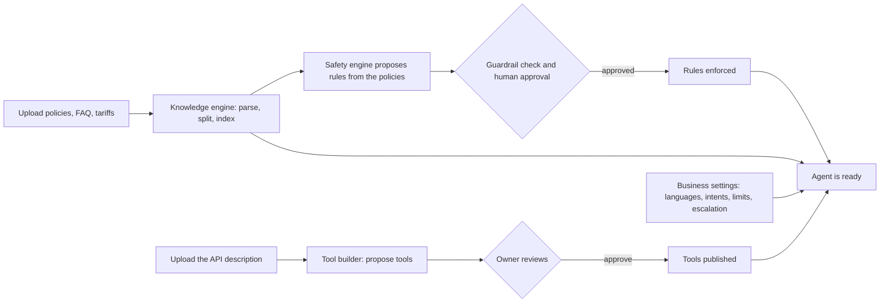
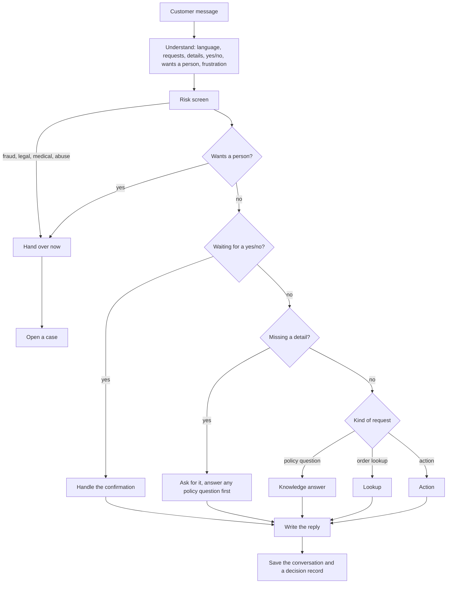
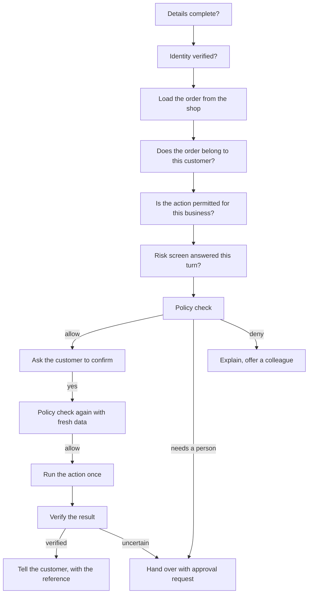
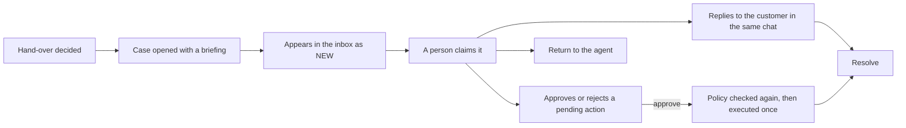

# Ticket-Easy: how the whole system works

Ticket-Easy is a customer-service agent for online businesses. It answers customers in their own language (English, Egyptian Arabic, mixed, or Arabizi), takes real actions on the business's systems within limits the business sets, and hands over to a person, with a full briefing, whenever it should.

The system has six parts. The first four prepare the agent; the last two run it and keep people in control.

| Part | What it does |
|---|---|
| **Knowledge engine** | Reads the business's documents (PDF, Word, Excel, Markdown), splits them into passages, and finds the right passages for a question, with citations. |
| **Safety and policy engine** | Turns policies into rules, checks every action against them (allow, deny, or needs a person), and screens messages for fraud, legal, medical and abuse risks. |
| **Tool builder** | Reads the business's API description and proposes tools (look up an order, create a return…). The owner reviews and approves them. |
| **Agent brain** | Understands each message, decides what to do, talks to the customer, and records why. |
| **Support inbox** | Where people take over a case, read the briefing, reply, approve or reject. |
| **Manager dashboard** | Shows what the agent answered, did and could not do, and raises alerts. |

---

## 1. Setting up a business (once, then whenever policies change)

1. **Documents** are uploaded. The knowledge engine indexes them. A newer version of a document supersedes the old one, and old passages are no longer quoted.
2. **Rules** are proposed from the policies ("refunds within 14 days"). Nothing is enforced until a person approves it, and a guardrail check blocks unsafe rules.
3. **Tools** are proposed from the business's API description. The owner switches on the ones they want. Risky tools default to needing a person.
4. **Settings** name the business's languages, the requests it handles (intents), escalation limits and priorities.

Changing a policy means uploading a new document, not changing code.

---

## 2. What happens to one customer message

Every turn ends in exactly one outcome: **answer, clarify, verify identity, confirm, execute, refuse, or hand over**, and the reason is stored in a decision record.

**Understanding** is done by an AI model. Code checks what it returns: only known request types, details that really appear in the message, and safety flags that the model can raise but never clear.

### 2a. Policy questions
1. An AI model rewrites the question into a clean search query (it understands Arabizi and follow-ups).
2. The knowledge engine returns the best passages using meaning-based and keyword search.
3. The model writes a direct answer from those passages only, in the customer's style.
4. Code rejects any answer that adds a number, date, fee or link the passages do not contain, and falls back to quoting the passages.
5. The passages are always shown underneath with their citations.
6. If nothing answers the question: ask the customer to rephrase, then say honestly it is not in the policies and offer a person, and hand over only the third time in a row.

### 2b. Order lookups
Order details are shown only after identity is verified (order number plus the phone number on the order) and ownership is confirmed. Another customer's order is never revealed.

### 2c. Actions (refund, return, exchange, cancel, change address, voucher, complaint)
Always in this order. If any step cannot run, nothing happens and the case goes to a person.

**The policy check has two keys.** The rule engine decides from approved rules. An AI policy agent reads the relevant policy passages and gives its own route. The stricter answer wins, so the agent can send a case to a person or refuse, but can never turn a "no" into a "yes". If the agent is unavailable, an otherwise allowed action waits for a person.

Other safeguards:
- A written action is never retried automatically; an uncertain outcome goes to a person.
- "Done" is only said after the shop's answer is verified (success, audit id, reference).
- A person can never turn a policy "deny" into an execution.
- A first "no" is explained and a colleague is offered; asking again hands the case over.

### 2d. Writing the reply
Replies start from a decision and its facts, then an AI model words them for this customer: warm, in their language and style, reacting to what they just said. Code checks that the wording keeps every number, date, id and reference and adds none. Execution results ("Done, reference RET-…") are never reworded. Only a hand-over message may say a colleague is coming.

While the customer waits, the chat shows a "working on it" bubble with a short progress line.

---

## 3. Handing over to a person

- The **briefing** holds the conversation, the verified customer and order facts, what the agent already tried, the policy passages involved, similar past tickets, and a suggested next step.
- Cases have a priority and a time limit (urgent, high, normal). The inbox shows new cases first and open plus claimed by default.
- While a person owns the chat the agent stays quiet; the customer's later messages are added to the case.
- A person's reply or approval reaches the customer live in the same conversation.

---

## 4. Watching and improving

- The **dashboard** shows conversations, escalations, tool use, response times, and unanswered questions grouped by topic.
- **Alerts** open when something goes wrong: a service down, an action failing, an unverified result, too many escalations, slow replies, a question asked often that no document answers.
- **Unanswered questions** tell the owner which document to upload next, which closes the loop back to setup.

---

## 5. Safety rules that never change

1. The AI model proposes, code decides: identity, ownership, permission, policy, confirmation and result verification are checked by code.
2. Nothing is invented: no policy claim without a passage and its citation, no order fact without a shop answer.
3. Fail closed: if a check cannot run, no side effect happens and a person is told.
4. Personal data (phone, email, card, address) is hidden in logs and stored records.
5. Every answer and action has a decision record that can be opened later.
6. Staff sign in with roles, and each person sees only their businesses.

---

## 6. Where the project stands

| Area | Status |
|---|---|
| Understanding, replies, knowledge answers, policy agent | Working with an AI model |
| Knowledge engine, rule checking, risk screen | Working |
| Inbox, dashboard, alerts, sign-in | Working |
| Tool builder | Working on its own (proposal, review, sandbox) |
| **Connection between the tool builder and the agent** | **Not done yet.** The agent currently acts on a built-in practice shop, so no real business system is changed. |
| Customer channels | Web chat only; WhatsApp and Instagram are not built |
| Packaging | Runs locally without Docker; the Docker demo still starts the agent without the knowledge and safety engines |
