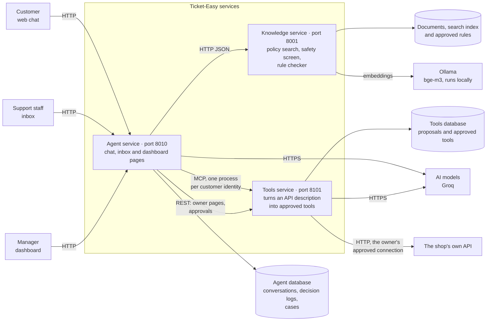
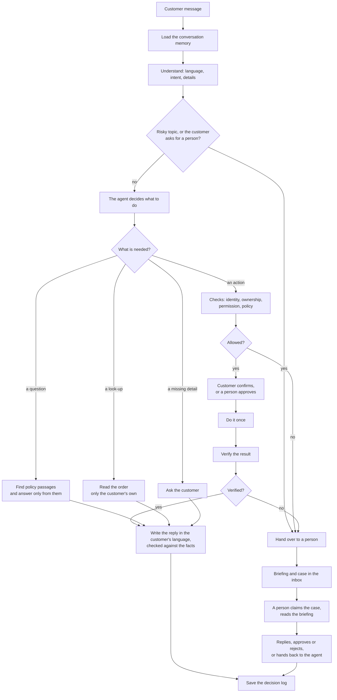
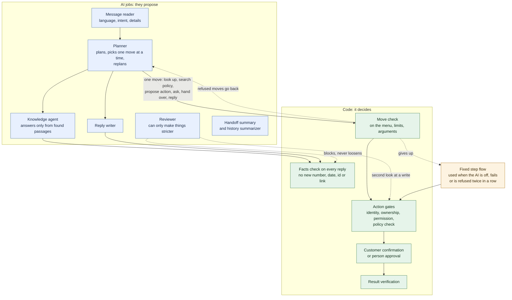
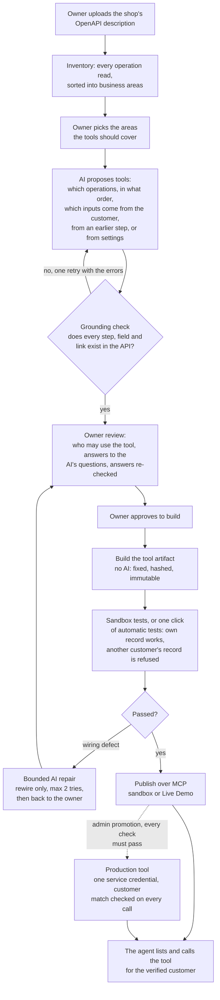

# Ticket-Easy

**Plug in your business. Get a customer-service agent that actually does the work.**

Ticket-Easy is an AI agent for Egyptian businesses. It answers customers in their own language, takes real actions on your systems within the limits you set, and hands over to a person, with a full briefing, the moment it should not act.

---

## Watch the demo

| Language | Video | What it shows |
|---|---|---|
| English | [Business demo (English)](https://drive.google.com/file/d/11M3dIk6nNhw7h3NHtOAoz1LTh4T6d6dR/view?usp=sharing) | Ticket-Easy shown to a business owner, narrated in English |
| Arabic | [Business demo (Arabic)](https://drive.google.com/file/d/1nhfriQphCIe3XJleemFjyXSOWCRUhWWf/view?usp=sharing) | The same demo, narrated in Arabic |

---

## Why Ticket-Easy

Every business gets the same messages all day: *where is my order, why did my bill change, can I move my booking, I want a refund.* People answering them is slow and expensive at night. A scripted chatbot breaks on the first real question. A custom build takes months. None of them write the way Egyptians do: Arabic, English, and both in one sentence.

Ticket-Easy does three things a scripted bot does not:

- **It reads your policies and follows them.** It answers from your documents and shows the exact passage it used. If the answer is not there, it says so instead of guessing.
- **It acts, within limits you set.** The platform builds tools from your API description: look up an order, open a ticket, create a return. Every action is checked against your rules first. "Refunds within 14 days" is a wall the agent cannot cross.
- **It knows when to stop.** Fraud signals, regulator complaints, anything outside policy: the case goes to a person with the conversation, the customer's data, what the agent already tried and a suggested next step. Nobody asks the customer to repeat anything.

It works for any business with written policies and customer data. We start with e-commerce and telecom, and a new industry needs a schema and a set of policies, not a new project.

---

## How it works

### System architecture



Three separate services talk to each other only over the network; none uses another's code. The **agent service** is the only one customers and staff reach, and it also serves the manager dashboard. The **knowledge service** finds policy passages, screens risky messages and checks every action against the approved rules. The **tools service** turns a shop's API description into tools the owner approves, and the agent calls them over MCP. AI models are used for understanding, planning and wording; local embeddings (Ollama with bge-m3) power the search.

### What happens to a message



Every message ends in one outcome: an answer, a question, a confirmation, an action, a refusal or a hand-over, and the decision log records why. A write is never repeated automatically: if its result is unclear, the case goes to a person.

### Inside the agent



*AI proposes, code decides.* A move is only a proposal: it never calls a tool, clears a safety flag or skips a check by itself. The planner and the reviewer use the strong model slot, the message reader, the reply writer and the summaries use the small slot, and search uses the local embedding model.[^models] Handoff and the history summaries are checked too: a text that adds a number, date or id that was not in the source is rejected and a fixed template is used.

---

## Where the tools come from

Nobody writes integration code for Ticket-Easy. The owner gives the **tools service** the shop's API description (an OpenAPI file, uploaded or fetched from the running system), and the service turns it into tools the agent can call. The AI only proposes; the owner approves, and code builds, tests and publishes.



1. **Discover.** The service reads the API offline and keeps the original file. Large APIs are split into business areas and processed in batches, so any size of API fits the model.
2. **Propose.** The model, with structured output only, drafts each tool: the operations to call, their order and where every input comes from. It cannot run anything.
3. **Ground.** Code rejects any proposal that names an operation, field or link the API does not have, or that maps a value to an incompatible type. A failed proposal is retried once with the errors; it is never replaced by a canned one.
4. **Review.** The owner decides who may use the tool (the customer's own records only, for example) and answers the AI's questions in plain language. Another model call checks the answers, and approval stays blocked until every question is resolved.
5. **Build.** An approved proposal is compiled, without any model, into an immutable artifact: steps, schemas, access rules and limits, all hashed. Anything the executor cannot do exactly (an unsupported auth or parameter style) is refused at this point rather than guessed.
6. **Test.** Tests run against a sandbox copy of the shop: a normal success, the customer's own record, and an attempt to read someone else's record that must be refused. If a test fails because of a bad mapping, the model may repair it, twice at most; it can rewire steps but never add operations or loosen access.
7. **Publish.** Only a tool with passing evidence is published, as an MCP tool, for the sandbox or as a Live Demo tool against the owner's real API. Every call re-checks the approval, the access rules and the latest test results, so disabling a tool takes effect on the next call.
8. **Use.** The agent discovers the tools over MCP, one process per customer identity, so no tool argument can choose whose data to read. Results come back with a status the agent must respect: a partial or unknown write is never treated as success and goes to a person.
9. **Production.** A tool becomes production only when an admin promotes it and every automatic check passes (same approved version, access scoped to the verified customer, rate limits, a rollback contact, a smoke check). One service credential then serves all customers, and the tools service itself checks, on every call, that the record belongs to the customer. An error spike rolls the tool back automatically.

Details, settings and the full list of limits are in the [tools service README](services/tools/README.md).

---

## Run the demo

You need [Docker Desktop](https://www.docker.com/products/docker-desktop/) running. Nothing else: no Python, no Node.

```bash
make demo
```

The first start takes a few minutes. When it is ready it prints three links:

| Link | What you see |
|---|---|
| <http://localhost:8010/chat?tenant_id=shop_001> | the customer chat |
| <http://localhost:8010/inbox> | where staff take over a case |
| <http://localhost:8010/dashboard> | the manager dashboard, already filled with example conversations |

Things to try in the chat (the demo shop is "Nile Style"; it understands English, Egyptian Arabic and Arabizi such as `3ayez araga3 el order`):

- `Where is my order NS-20877?`, then the phone `01012345601`: the agent verifies you and reads the order.
- `What is your return policy?`: it answers from the policy and shows the passage.
- `I want a refund for order NS-20934`, then `01098765405`: a large refund needs a person. Open the **inbox**, claim the case, read the briefing, approve or reject the refund, and watch the dashboard update.

`make demo` answers by rules and needs no internet. `make demo-full` adds a local AI model (about 5 GB the first time, 8 GB of free memory). `make demo-live` runs the agent against the real knowledge service and starts the tools service too; it needs Ollama with `ollama pull bge-m3` done once. `make logs` shows what it does, `make down` stops it (your data is kept), `make reset` deletes what it stored.

The inbox and the dashboard need a sign-in: `make demo` creates `admin@example.com` and prints its password once (lost it? `make urls` shows how to reset). Every setting is explained in `.env.example`. To run everything without Docker (needs Python 3.12+, Node 20+ and [uv](https://docs.astral.sh/uv/)):

```bash
python ops/local/setup.py        # once: environments, knowledge index, dashboard build, settings files
python ops/local/serve.py up     # starts all services; `serve.py down` stops them
python ops/local/e2e_chat.py     # optional: checks the whole stack end to end
```

Create the two demo business tools once, with a model key (Groq or OpenRouter, or a running Ollama) in `services/tools/.env`; without them the agent uses its built-in demo shop and everything else still works (steps in [docs/INTEGRATION.md](docs/INTEGRATION.md), which also covers the sandbox and live-demo modes).

---

## What it can do

- **Languages:** English, Egyptian Arabic, mixed Arabic-English, and Arabizi.
- **Real actions, with checks and approvals:** look-ups, returns, refunds, cancellations, vouchers, tickets. Writes are confirmed by the customer, large ones approved by a person, and the result is verified before the agent says "done".
- **Hand-over with a full briefing:** the conversation, the customer's data, the policy passages used, what was tried and why it stopped.
- **A manager dashboard:** what was answered, what was done, what the agent could not do, alerts, and which document to add next.
- **Tools generated from an API description:** an owner uploads an OpenAPI file, reviews the proposed tools, tests them in a sandbox and switches them on (see [Where the tools come from](#where-the-tools-come-from)).

## Built with safety first

- The agent never invents: no policy claim without a passage, no order fact without a result from the shop, no "done" without a verified result.
- Every action passes the same checks in the same order, and a check that cannot run stops the action and hands the case to a person.
- High-risk actions need a person; a person can never turn a "no" from the rules into a "yes".
- Identity is verified before any customer data is touched, and one customer can never read another's order. Generated tools enforce this too: a tool is published only after a test proves another customer's record is refused.
- AI never builds a tool on its own: every tool is checked against the API, approved by the owner, tested, and re-checked on every call.
- Every answer and every action is logged with the reason.

## Results

Measured on the evaluation set; every figure comes from the [evaluation and cost report](docs/reports/Ticket-Easy_Eval_and_Cost_Report.md) (section 1.2 unless noted).

| What | Result | Source in the report |
|---|---|---|
| Scripted safety scenarios (real refunds, cancellations, vouchers, exchanges) | 83 of 83 pass, 0 unsafe actions | section 1.2 |
| Guardrail cases | 44 of 44, 0 blocked actions executed | section 1.2 |
| Finding the right policy passage (recall@5, held-out questions) | shop_001 89.29%, noon_eg 97.5%, telco_001 82.22% | section 1.2 |
| Understanding the customer (intent), English / Arabic / mixed | 95.0% / 95.0% / 93.3% | section 1.2 |
| Reply in the customer's language | 99.5% | section 1.2 |
| Cost so far | $0 spent; the measured tokens would cost 3.843 USD per 1,000 messages at paid list prices | section 2.6 |

The report also lists the honest gaps against the targets (section 1.7).

## Project layout

| Folder | What is in it |
|---|---|
| [`services/knowledge/`](services/knowledge/README.md) | The knowledge service: documents, search, safety screen, rule checker |
| [`services/agent/`](services/agent/README.md) | The agent service: chat, understanding, decisions, actions, hand-off, inbox |
| [`services/tools/`](services/tools/README.md) | The tools service: API description in, approved tools out |
| [`apps/dashboard/`](apps/dashboard/README.md) | The manager dashboard (React), built into the agent |
| `ops/local/` | Start all services locally and the end-to-end checks |
| `ops/` | `check_names.py` and `check_links.py`, the two repository-wide checks |
| [`contracts/`](contracts/README.md) | The published data formats between the services |
| `docs/` | Guides, plans and reports |
| `docker-compose.yml`, `Makefile` | The one-command demo |

---

*Ticket-Easy: your policies, your data, one agent that follows both.*

## People

- George Emil ([@georgeemiL787](https://github.com/georgeemiL787))
- Asmaa Nazeh ([@Asmaa-Nazeh](https://github.com/Asmaa-Nazeh))
- Omar Essam ([@omarEssam-11](https://github.com/omarEssam-11))
- Basel Elhofy ([@Basel-Elhofy](https://github.com/Basel-Elhofy))
- Basmala Hesham ([@pasmala2004](https://github.com/pasmala2004))

[^models]: Which model runs each job is set in the agent's settings (`AGENT_LLM_MODEL_<JOB>`); the minimum stack and its cost are in section 2.1 of the [evaluation and cost report](docs/reports/Ticket-Easy_Eval_and_Cost_Report.md).
