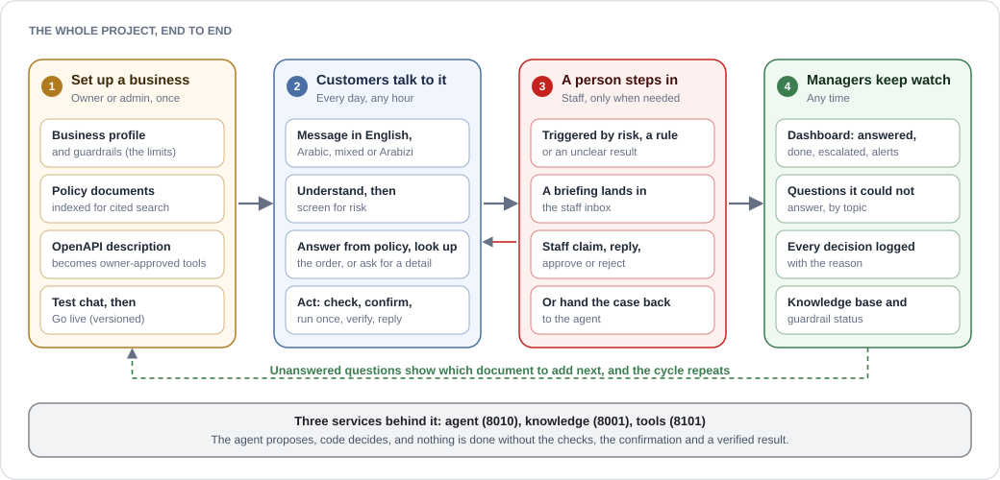
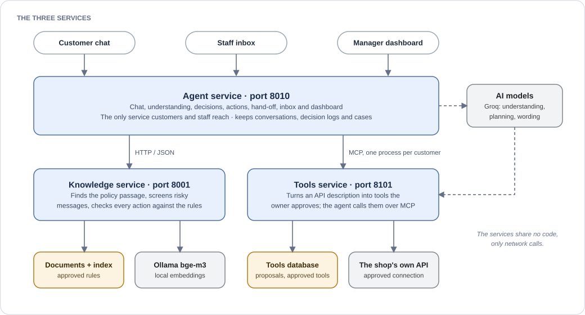
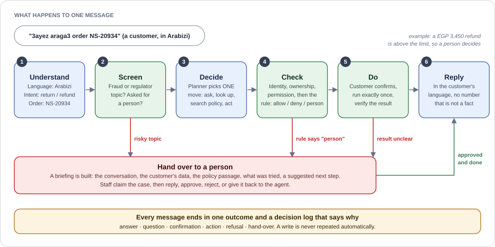
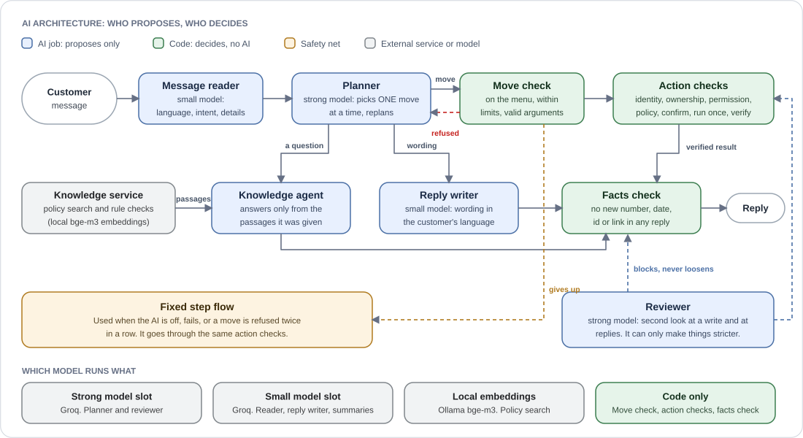
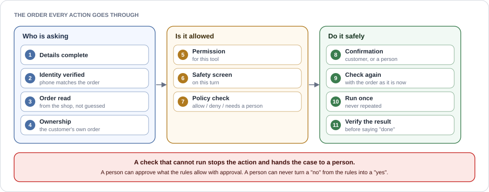
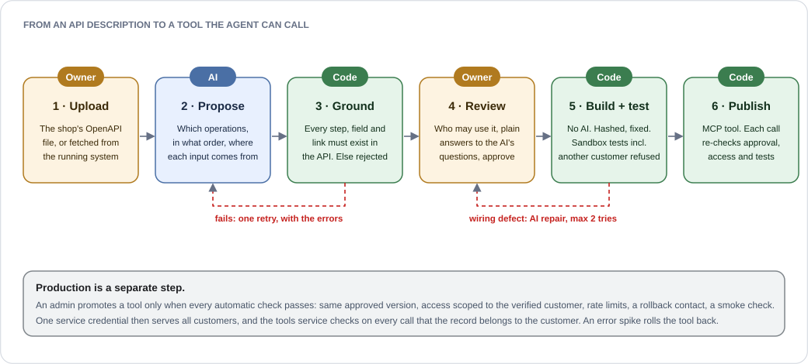

<div align="center">

# Ticket-Easy

### Plug in your business. Get a customer-service agent that actually does the work.

An AI agent for Egyptian businesses. It answers customers in their own language, takes real actions on your systems **within limits you set**, and hands over to a person, with a full briefing, the moment it should not act.


[**Watch the demo**](#watch-the-demo) · [**Why**](#why-ticket-easy) · [**How it works**](#how-it-works) · [**Run it**](#run-the-demo) · [**Results**](#results) · [**Layout**](#project-layout)

</div>

<p align="center"></p>

---

## Watch the demo

| Language | Video | What it shows |
|---|---|---|
| English | [Business demo (English)](https://drive.google.com/file/d/11M3dIk6nNhw7h3NHtOAoz1LTh4T6d6dR/view?usp=sharing) | Ticket-Easy shown to a business owner, narrated in English |
| Arabic | [Business demo (Arabic)](https://drive.google.com/file/d/1nhfriQphCIe3XJleemFjyXSOWCRUhWWf/view?usp=sharing) | The same demo, narrated in Arabic |

---

## Why Ticket-Easy

Every business gets the same messages all day: *where is my order, why did my bill change, can I move my booking, I want a refund.* People answering them is slow and expensive at night. A scripted chatbot breaks on the first real question. A custom build takes months. None of them write the way Egyptians do: Arabic, English, and both in one sentence.

| | What it means |
|---|---|
| **It reads your policies and follows them** | It answers from your documents and shows the exact passage it used. If the answer is not there, it says so instead of guessing. |
| **It acts, within limits you set** | The platform builds tools from your API description: look up an order, open a ticket, create a return. Every action is checked against your rules first. "Refunds within 14 days" is a wall the agent cannot cross. |
| **It knows when to stop** | Fraud signals, regulator complaints, anything outside policy: the case goes to a person with the conversation, the customer's data, what the agent already tried and a suggested next step. Nobody asks the customer to repeat anything. |

It works for any business with written policies and customer data. The agent ships with two e-commerce shops (the demo shop "Nile Style" and a noon-style marketplace); the knowledge service already holds a telecom business too (policies, rules and a 204-question benchmark). A new business needs a profile, its policies and an API description, not a new project.

---

## How it works

### The three services

<p align="center"></p>

The three services talk to each other only over the network; none uses another's code. Customers, staff and managers reach only the **agent service**. The **knowledge service** finds the policy passage and decides whether an action is allowed. The **tools service** turns the shop's API description into tools the owner approves.

| Service | Port | Folder | Owns |
|---|---|---|---|
| Agent | 8010 | [`services/agent/`](services/agent/README.md) | chat, understanding, decisions, actions, hand-off, inbox, dashboard, business setup |
| Knowledge | 8001 | [`services/knowledge/`](services/knowledge/README.md) | documents, cited search, safety screen, `allow` / `deny` / `require_human` |
| Tools | 8101 | [`services/tools/`](services/tools/README.md) | API description in, approved and tested MCP tools out |

### What happens to a message

<p align="center"></p>

Follow the example above: the customer asks for a return in Arabizi. The agent reads the language, the intent and the order number. The rule check says a refund this large needs a person, so the case goes to the inbox with a full briefing instead of the agent refunding on its own. Once staff approve, the agent checks again with the order as it is now, runs the refund exactly once, verifies it and replies in Arabizi.

### AI proposes, code decides

<p align="center"></p>

A move chosen by the AI is only a proposal: it never calls a tool, clears a safety flag or skips a check by itself. The planner and the reviewer use the strong model, the message reader, reply writer and summaries use the small one, and search uses a local embedding model. A summary or reply that adds a number, date or id that was not in the source is rejected and a fixed template is used instead.

### The order every action goes through

<p align="center"></p>

---

## Where the tools come from

Nobody writes integration code for Ticket-Easy. The owner gives the **tools service** the shop's API description (an OpenAPI file, uploaded or fetched from the running system), and the service turns it into tools the agent can call. The AI only proposes; the owner approves, and code builds, tests and publishes.

<p align="center"></p>

The checks that matter most:

- **Grounding:** code rejects any proposal that names an operation, field or link the API does not have. A failed proposal is retried once with the errors and is never replaced by a canned one.
- **No AI in the build:** an approved proposal is compiled into an immutable, hashed artifact. Anything the executor cannot do exactly is refused rather than guessed.
- **A safety test before publishing:** the sandbox test includes an attempt to read another customer's record, and it must be refused.
- **One customer per process:** the agent calls tools over MCP with one process per customer identity, so no tool argument can choose whose data to read. A partial or unknown write is never treated as success.

<details>
<summary><b>The nine stages in detail</b></summary>

<table>
<tr><td width="150"><b>1 · Discover</b></td><td>The service reads the API offline and keeps the original file. Large APIs are split into business areas and processed in batches, so any size of API fits the model.</td></tr>
<tr><td><b>2 · Propose</b></td><td>The model, with structured output only, drafts each tool: the operations to call, their order and where every input comes from. It cannot run anything.</td></tr>
<tr><td><b>3 · Ground</b></td><td>Code rejects any proposal that names an operation, field or link the API does not have, or that maps a value to an incompatible type.</td></tr>
<tr><td><b>4 · Review</b></td><td>The owner decides who may use the tool (the customer's own records only, for example) and answers the AI's questions in plain language. Approval stays blocked until every question is resolved.</td></tr>
<tr><td><b>5 · Build</b></td><td>An approved proposal is compiled, without any model, into an immutable artifact: steps, schemas, access rules and limits, all hashed.</td></tr>
<tr><td><b>6 · Test</b></td><td>Tests run against a sandbox copy of the shop: a normal success, the customer's own record, and another customer's record, which must be refused. If a test fails because of a bad mapping, the model may repair it, twice at most; it can rewire steps but never add operations or loosen access.</td></tr>
<tr><td><b>7 · Publish</b></td><td>Only a tool with passing evidence is published, as an MCP tool, for the sandbox or as a Live Demo tool against the owner's real API. Every call re-checks the approval, the access rules and the latest test results, so disabling a tool takes effect on the next call.</td></tr>
<tr><td><b>8 · Use</b></td><td>The agent discovers the tools over MCP and calls them for the verified customer only.</td></tr>
<tr><td><b>9 · Production</b></td><td>A tool becomes production only when an admin promotes it and every automatic check passes (same approved version, access scoped to the verified customer, rate limits, a rollback contact, a smoke check). An error spike rolls the tool back automatically.</td></tr>
</table>

</details>

Details, settings and the full list of limits are in the [tools service README](services/tools/README.md); how the agent and the tools service fit together is in [docs/INTEGRATION.md](docs/INTEGRATION.md).

---

## Run the demo

You need [Docker Desktop](https://www.docker.com/products/docker-desktop/) running. Nothing else: no Python, no Node.

```bash
make demo
```

The first start takes a few minutes. When it is ready it prints three links:

| Link | What you see |
|---|---|
| <http://localhost:8010/chat?tenant_id=shop_001> | the customer chat |
| <http://localhost:8010/inbox> | where staff take over a case |
| <http://localhost:8010/dashboard> | the manager dashboard, already filled with example conversations |

### Things to try

The demo shop is "Nile Style". It understands English, Egyptian Arabic and Arabizi such as `3ayez araga3 el order`.

| Say this | What happens |
|---|---|
| `Where is my order NS-20877?`, then the phone `01012345601` | the agent verifies you and reads the order |
| `What is your return policy?` | it answers from the policy and shows the passage |
| `I want a refund for order NS-20934`, then `01098765405` | a large refund needs a person: open the **inbox**, claim the case, read the briefing, approve or reject the refund, and watch the dashboard update |

### Other ways to start

| Command | What it runs |
|---|---|
| `make demo` | the agent with its built-in demo shop; answers by rules, needs no internet |
| `make demo-full` | adds a local AI model (about 5 GB the first time, 8 GB of free memory) |
| `make demo-live` | the agent against the real knowledge service and the tools service (<http://localhost:8101>); needs Ollama with `ollama pull bge-m3` done once |
| `make logs` · `make down` · `make reset` | follow what it does · stop it (your data is kept) · delete what it stored |

The inbox and the dashboard need a sign-in: `make demo` creates `admin@example.com` and prints its password once (lost it? `make urls` shows how to reset). Every setting is explained in `.env.example`.

<details>
<summary><b>Run everything without Docker</b> (Python 3.13, Node 20+ and <a href="https://docs.astral.sh/uv/">uv</a>)</summary>

```bash
python ops/local/setup.py        # once: environments, knowledge index, dashboard build, settings files
python ops/local/serve.py up     # starts all services; `serve.py down` stops them, `serve.py status` shows what runs
```

Optional end-to-end check of the whole stack (run it with the agent's own environment, after the tool lifecycle below):

```bash
services/agent/.venv/bin/python ops/local/e2e_chat.py          # Windows: services\agent\.venv\Scripts\python ops\local\e2e_chat.py
```

Create the two demo business tools once, with a model key (Groq or OpenRouter, or a running Ollama) in `services/tools/.env`:

```bash
services/agent/.venv/bin/python ops/local/tools_lifecycle.py --tool order
services/agent/.venv/bin/python ops/local/tools_lifecycle.py --tool ticket
```

Without them the agent uses its built-in demo shop and everything else still works. The sandbox, Live Demo and production modes are explained in [docs/INTEGRATION.md](docs/INTEGRATION.md).

</details>

---

## What it can do

| | |
|---|---|
| **Languages** | English, Egyptian Arabic, mixed Arabic-English, and Arabizi. The reply comes back in the customer's own style. |
| **Real actions, with checks and approvals** | Look-ups, returns, refunds, cancellations, vouchers, exchanges, address changes, tickets. Writes are confirmed by the customer, large ones approved by a person, and the result is verified before the agent says "done". |
| **Hand-over with a full briefing** | The conversation, the customer's data, the policy passages used, what was tried and why it stopped. Staff claim, reply, approve, reject, resolve or give the case back to the agent. |
| **A manager dashboard** | What was answered, what was done, what the agent could not do, escalations, alerts, the questions it could not answer (which document to add next), the knowledge base and the guardrails. English and Arabic, right-to-left included. |
| **Onboarding a new business** | An admin sets a business up from nothing to live in the dashboard: profile, documents, guardrails, tools, a test chat, then **Go live**. Setups are versioned and can be rolled back. |
| **Tools generated from an API description** | An owner uploads an OpenAPI file, reviews the proposed tools, tests them in a sandbox and switches them on (see [Where the tools come from](#where-the-tools-come-from)). |

## Built with safety first

- **The agent never invents:** no policy claim without a passage, no order fact without a result from the shop, no "done" without a verified result.
- **Every action passes the same checks in the same order,** and a check that cannot run stops the action and hands the case to a person.
- **High-risk actions need a person;** a person can never turn a "no" from the rules into a "yes".
- **Identity is verified before any customer data is touched,** and one customer can never read another's order. Generated tools enforce this too: a tool is published only after a test proves another customer's record is refused.
- **AI never builds a tool on its own:** every tool is checked against the API, approved by the owner, tested, and re-checked on every call.
- **Every answer and every action is logged with the reason.**

## Results

Measured on the evaluation set; every figure comes from the [evaluation and cost report](docs/reports/Ticket-Easy_Eval_and_Cost_Report.md) (section 1.2 unless noted).

| What | Result | Source |
|---|---|---|
| Scripted safety scenarios (real refunds, cancellations, vouchers, exchanges) | **83 of 83** pass, 0 unsafe actions | section 1.2 |
| Guardrail cases | **44 of 44**, 0 blocked actions executed | section 1.2 |
| Finding the right policy passage (recall@5, held-out questions) | shop_001 **89.29%** · noon_eg **97.5%** · telco_001 **82.22%** | section 1.2 |
| Understanding the customer (intent), English / Arabic / mixed | **95.0% / 95.0% / 93.3%** | section 1.2 |
| Reply in the customer's language | **99.5%** | section 1.2 |
| Cost so far | **$0 spent**; the measured tokens would cost 3.843 USD per 1,000 messages at paid list prices | section 2.6 |

The report also lists the honest gaps against the targets (section 1.7): replies that cite the right passage (70.7% against a 95% target) and the decision accuracy (81.7% against 92%) are below target in agent mode, and the fixed flow is the safety net while they improve.

**Tests:** about 5,900 automatic tests across the agent, knowledge and tools services and the dashboard, plus a scenario report, a schema-drift check, a names check and a Markdown link check, all run on every pull request ([`.github/workflows/ci.yml`](.github/workflows/ci.yml)).

## Project layout

| Folder | What is in it |
|---|---|
| [`services/agent/`](services/agent/README.md) | The agent service: chat, understanding, decisions, actions, hand-off, inbox, onboarding |
| [`services/knowledge/`](services/knowledge/README.md) | The knowledge service: documents, search, safety screen, rule checker |
| [`services/tools/`](services/tools/README.md) | The tools service: API description in, approved tools out |
| [`apps/dashboard/`](apps/dashboard/README.md) | The manager dashboard (React), built into the agent |
| [`contracts/`](contracts/README.md) | The published data formats between the services |
| `ops/local/` | Start all services locally, the demo shop API, the tool lifecycle and the end-to-end checks |
| `ops/` | `check_names.py` and `check_links.py`, the two repository-wide checks |
| [`docs/`](docs/INTEGRATION.md) | Guides (such as [integration](docs/INTEGRATION.md)), plans and reports |
| `docker-compose.yml`, `Makefile` | The one-command demo |

---

<div align="center">

*Ticket-Easy: your policies, your data, one agent that follows both.*

</div>

## People

- George Emil ([@georgeemiL787](https://github.com/georgeemiL787))
- Asmaa Nazeh ([@Asmaa-Nazeh](https://github.com/Asmaa-Nazeh))
- Omar Essam ([@omarEssam-11](https://github.com/omarEssam-11))
- Basel Elhofy ([@Basel-Elhofy](https://github.com/Basel-Elhofy))
- Basmala Hesham ([@pasmala2004](https://github.com/pasmala2004))

