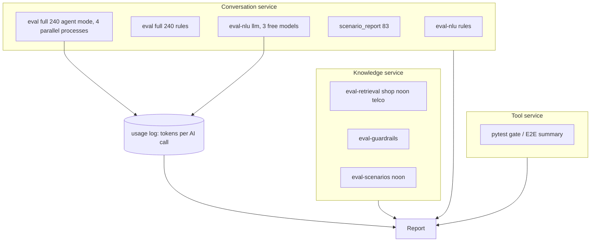

# Ticket-Easy Eval Pipeline & Model Cost Report

Updated 16 October 2026 with five changes: agent mode is the AI run; the full AI run fits the free tier through four parallel processes; tokens are measured, not estimated; a small measured model comparison; service names instead of letters in the report.

## Deliverable

One detailed Markdown report (chart-ready tables you can paste into slides):

`[docs/reports/Ticket-Easy_Eval_and_Cost_Report.md](docs/reports/Ticket-Easy_Eval_and_Cost_Report.md)`

Supporting raw outputs stay under:

- `services/knowledge/reports/` (or stdout captured into `docs/reports/eval_runs/`)
- `services/agent/reports/eval_*_<date>.json|.md`
- `docs/reports/eval_runs/` — consolidated CSVs/JSON excerpts for charts, and the token usage logs (`usage_*.jsonl`)

**Naming in the report:** the report says **knowledge service** (knowledge_service), **conversation service** (agent_service) and **tool service** (tools_service). Old letter names appear nowhere in headings, tables or narrative.

**Arabizi policy:** still run all four styles so numbers stay comparable to baselines, but the report leads with **English + Arabic + mixed** aggregates. Arabizi appears only as a short appendix row, not a selling narrative.

**Branch:** all work on a new branch made from `the integration branch`. Nothing is merged. Step 0 runs every test suite on that branch first, because the integration branch has never been run in CI; only failures that block the measurements are fixed.

---

## Part 1 — Evaluation pipeline & results (full refresh)

### What we re-run

| Layer               | Command / source                                                                                                                                    | Success check                                                                   |
| ------------------- | --------------------------------------------------------------------------------------------------------------------------------------------------- | ------------------------------------------------------------------------------- |
| Branch health       | agent_service `make test && make lint && make scenarios`; knowledge_service `PYTHONPATH=src python -m pytest -q`; tools_service `python -m pytest -q`; dashboard `npm test` | All green before any measurement                                                |
| Retrieval           | `python -m knowledge_service eval-retrieval --tenant shop_001\|noon_eg\|telco_001` (test + note dev)                                                           | recall@5, no-answer P/R captured                                                |
| Guardrails          | `python -m knowledge_service eval-guardrails`                                                                                                                  | **44/44**, 0 blocked actions executed                                           |
| Noon scenarios      | `python -m knowledge_service eval-scenarios --tenant noon_eg` (after `db build`)                                                                               | section_recall@5                                                                |
| NLU                 | `python -m agent_service eval-nlu --mode rules`                                                                                                            | intent ≥ baseline − 0.02                                                        |
| Conversations       | `python -m agent_service eval --set eval/conversations --label presentation_rules`                                                                         | full **240**; EN/AR/mixed highlighted                                           |
| Conversations + AI  | 4 parallel processes, one per style (see below), `--llm --agent-mode on --judge --resume`                                                           | full **240** in agent mode; if a style cannot finish, its largest complete batch with sample size stated |
| Model comparison    | `python -m agent_service eval-nlu --mode llm` once per Groq model (see Part 2)                                                                        | intent accuracy + tokens + latency per model                                    |
| Scenarios           | `python -m agent_service.scripts.scenario_report` / `make scenarios`                                                                                       | **83** active pass                                                              |
| Safety spot-check   | Existing adversarial/property suites already in CI; cite latest green + reconfirm eval measures `wrong_or_unapproved_actions=0`, `unbacked_facts=0` | Must stay **0**                                                                 |
| Tool service        | Cite `[services/tools/E2E_FINAL_REPORT.md](services/tools/E2E_FINAL_REPORT.md)` + run focused gate tests if needed                                                  | Publication/sandbox verdicts                                                    |

### Full 240 AI run on the free tier (locked)

The AI run is **agent mode** (`--agent-mode on`), because that is what we present.

**All AI helpers on.** In code, the four AI helper switches default to off (`services/agent/src/agent_service/config.py`: `llm_rewrite`, `llm_policy`, `llm_knowledge`, `llm_review` = False); only `.env.example` turns them on. Every AI run (the 240 agent run and the model comparison) must set `AGENT_LLM_REWRITE=1`, `AGENT_LLM_POLICY=1`, `AGENT_LLM_KNOWLEDGE=1`, `AGENT_LLM_REVIEW=1`, plus a model for every job (orchestrator, reader, knowledge, reviewer, writer, summary, judge). Before the long run, check one trace: it must show agent moves and the AI writer, knowledge and reviewer steps, not templates.

Several keys in one process do not add speed: the LLM client only switches key when one hits a rate limit, and all keys share one rate budget per model. Separate processes each get their own budget, so:

1. Make four folders, one per style: `eval_runs/sets/en/en.jsonl`, `.../ar/ar.jsonl`, `.../mixed/mixed.jsonl`, `.../arabizi/arabizi.jsonl` (copies of `services/agent/eval/conversations/*.jsonl`).
2. Start four processes at the same time, each with its own Groq key and the same model settings:
   `AGENT_LLM_API_KEY=<key N> python -m agent_service eval --set eval_runs/sets/<style> --llm --agent-mode on --judge --label presentation_agent_<style> --resume`
3. If a process stops on the daily limit, re-run the same command later; `--resume` continues where it stopped.
4. Merge the four per-style JSON reports in the aggregation step (recompute totals from per-turn results, not by averaging percentages).

Arabizi is run last and may use `--per-style` to keep it small. Every latency figure is labelled "measured on the Groq free tier".

### Extra validation (only where it strengthens the story)

1. **Style rollups:** Add EN+AR+mixed aggregate tables (exclude Arabizi from headline %).
2. **Baseline delta:** `eval-compare` presentation run vs `[services/agent/eval/baseline_phase0.json](services/agent/eval/baseline_phase0.json)` / `[eval_baseline.json](services/agent/eval/eval_baseline.json)`, and agent run vs rules run.
3. **Safety invariant block:** One table proving zero wrong writes / unbacked facts on the fresh run (the sales "trust" slide).
4. **Scenario coverage check:** Confirm shop_001 + noon_eg file counts and zero pending.
5. **Retrieval split hygiene:** Reconfirm test numbers only on held-out splits (no `--sweep` on test).

No new product features. The only code changes are the token usage log (Part 2) and small report helpers under `docs/reports/eval_runs/` to merge per-style runs and build rollups.

### Report section outline (Eval)

1. **Pipeline diagram** — gold data → harness → baselines → CI weekly artifact (`[.github/workflows/eval.yml](.github/workflows/eval.yml)`)
2. **Headline results** (sales-first): safety 0/0, guardrails 44/44, retrieval recall, scenarios 83, languages EN/AR/mixed
3. **Knowledge service tables** — per tenant recall@5 / no-answer; guardrails
4. **Conversation service tables** — NLU; conversation metrics (intent/decision/citation/locale/handoff); rules run vs agent run side by side, rules shown as the starting point that agent mode improves on
5. **Tool service** — tool publication / E2E credibility (not chat quality %)
6. **How results are shared** — committed baselines, `reports/`, GitHub artifacts, dashboard metrics (`[services/agent/docs/metrics.md](services/agent/docs/metrics.md)`)
7. **Honest gaps** — conversation accuracy vs 0.90/0.92/0.95 targets; framed as roadmap + model-stack opportunity (ties to Part 2)

---

## Part 2 — Models used & cost analysis

### Token usage: measured, not estimated

Every model answer already contains its exact token counts (`usage.prompt_tokens`, `usage.completion_tokens`); the conversation service reads them only to settle its rate limiter and then drops them (`services/agent/src/agent_service/adapters/llm.py`, `_settle`).

Small instrumentation change: when an environment variable such as `AGENT_USAGE_LOG=<path>` is set, the LLM client appends one JSON line per call: time, job (reader, orchestrator, knowledge, reviewer, writer, summary, judge), model, provider host, input tokens, output tokens, latency, status, run label. **Never prompt or reply text, customer data or keys.** Off by default; no effect on behaviour. Each eval process writes its own log under `docs/reports/eval_runs/`.

**Every component, same format.** The knowledge service and the tool service get the same log, written in the same line format with a `service` field (`conversation`, `knowledge`, `tools`), so one summary covers everything:

| Service | AI work logged | When it costs |
|---|---|---|
| Conversation service | reader, orchestrator, knowledge, reviewer, writer, writer_egyptian, summary, judge | every customer message |
| Knowledge service | search embedding of each query (`bge-m3`, local), risk second opinion (OpenRouter free) | every customer message that searches or is risk-screened |
| Knowledge service | document embeddings at indexing, rule extraction from policy documents (OpenRouter free) | once per business (onboarding) and when policies change |
| Tool service | tool generation and its other AI steps (triage, reconciliation, revision) | once per business (onboarding) |

Ollama embeddings report their token count (`prompt_eval_count`) when the server returns it; otherwise the count is a documented estimate and marked as such.

**Measured onboarding.** One real onboarding with the logs on: the tool service generates tools for the example e-commerce API (`scripts.live_smoke --example ecommerce`, Groq free tier) and the knowledge service extracts rules for `shop_001` (`rules extract`, OpenRouter free). This turns the onboarding cost line from an estimate into a measured number.

**Knowledge service per-message cost.** The conversation tests use a simulated for the knowledge service, so its tokens do not appear there. They are measured separately: average tokens per search query (from the retrieval runs with the log on) and per risk second opinion (on 40 labelled messages), then multiplied by the number of searches and risk checks per conversation counted in the agent run.

The report states: usage before this log existed was not recorded; the totals shown are measured over the presentation runs, with their dates.

If there is no time for this change, every token figure in the report is labelled **estimated** and computed as `messages × calls/msg × avg_tokens/call`, with the assumptions in the appendix.

### Measured model comparison (Groq only)

Cheap and real: run `python -m agent_service eval-nlu --mode llm` on all 155 labelled messages once per Groq model, changing only the model that does the understanding job, with the usage log on.

| Provider | Model id | Role today |
|---|---|---|
| Groq | `openai/gpt-oss-20b` | reader, summary, judge |
| Groq | `qwen/qwen3.8-27b` | knowledge, writer (preview model on Groq) |
| Groq | `openai/gpt-oss-120b` | orchestrator, reviewer |

Table: **Model · Intent accuracy (EN/AR/mixed) · Latency p50/p95 (Groq free tier) · Avg tokens in/out per call · List price $/1M in/out · Cost per 1,000 messages at list price**. This is the one model chart backed by measurement. OpenRouter models are not part of this comparison.

### What-if models (hypothetical, not tested)

These are the most widely used API models and well-known local models. **None of them is run.** For each, the report shows only what Ticket-Easy *would* cost with it: the measured tokens per job from the Groq runs × that model's public list price. Quality and speed cells read "not tested".

Two caveats printed under the table: different models count tokens differently (tokenizers), so the same text can be somewhat more or fewer tokens; and quality is unknown until a model is actually run.

**Cloud APIs (indicative prices per 1M tokens, input / output; vendor pages surveyed 6 October 2026 by [ActuIA](https://www.actuia.com/en/news/ai-api-pricing-in-october-2026-050-to-50-for-output/); E7 re-checks each price on the provider's own pricing page and uses that):**

| Provider | Model | Tier | Input | Output | Fits which jobs |
|---|---|---|---|---|---|
| OpenAI | GPT-6 Luna (`gpt-6-luna`) | small | 0.10 | 0.50 | reader, summary, writer |
| OpenAI | GPT-6.1 Sol (`gpt-6.1-sol`) | mid | 2.00 | 10.00 | orchestrator, reviewer |
| Google | Gemini 3.5 Flash-Lite | small | 0.30 | 2.50 | reader, summary |
| Google | Gemini 3.8 Flash | mid | 0.75 | 3.75 (introductory until 31 Dec 2026; then 1.50 / 7.50) | knowledge, writer, orchestrator |
| Anthropic | Claude Sonnet 5.5 | mid | 2.00 | 10.00 | orchestrator, reviewer |
| DeepSeek | `deepseek-flash` | small | 0.30 | 1.20 (off-peak 0.15 / 0.60) | reader, writer, summary |
| Mistral | Mistral Small 4 | small | 0.15 | 0.60 | reader, summary |
| Mistral | Mistral Large 3 | mid | 0.50 | 1.50 | knowledge, writer |

**Local, open-weight (run on own hardware; $0 API cost; hardware and electricity are estimated, see below):**

| Model | Size class | Fits which jobs | Rough GPU memory (4-bit unless noted) | Note |
|---|---|---|---|---|
| `gpt-oss-20b` (open weights) | 21B MoE, ~3.6B active | reader, summary, backup | ~16 GB | same model as today's Groq small slot, so quality carries over |
| `gpt-oss-120b` (open weights) | 117B MoE, ~5B active | orchestrator, reviewer, onboarding | ~80 GB (native 4-bit) | same model as today's Groq strong slot |
| Qwen 27B (same family as the Groq `qwen3.8-27b`, if its weights are published) | 27B | writer, knowledge (Arabic wording) | ~18-20 GB | mirrors today's Groq mix |
| Qwen3-30B-A3B | 30B MoE, ~3B active | reader, knowledge, writer | ~20 GB | fast for its size |
| Qwen3 32B | 32B dense | knowledge, writer, orchestrator | ~22 GB | stronger, slower than the MoE |
| Gemma 4 31B | 31B | knowledge, writer (multilingual) | ~22 GB | open weights |
| Mistral Small (open weights, ~24B) | 24B | reader, writer, summary | ~16 GB | |
| Llama 3.3 70B | 70B | orchestrator, reviewer | ~45 GB | needs a large GPU or two |
| Qwen3 8B | 8B | reader, summary | ~6 GB | already the demo default |
| Nile-Chat 4B | 4B | Egyptian Arabic writer only | ~4 GB | experimental, optional |
| `bge-m3` | embeddings | search | ~2 GB | already in use |

**Local hardware tiers (estimates only, nothing is bought or run):**

| Tier | Example hardware | Rough one-time price | Power draw | What it runs |
|---|---|---|---|---|
| L1 Starter | one 24-32 GB GPU workstation (RTX 4090/5090 class) | ~$3,500-5,000 | ~0.6 kW | Qwen3-30B-A3B for both slots, or gpt-oss-20b + Qwen 27B, plus bge-m3 |
| L2 Mirror of today | one 96 GB workstation GPU (RTX PRO 6000 class) | ~$10,000-12,000 | ~0.8 kW | gpt-oss-20b + Qwen 27B + gpt-oss-120b + bge-m3: the exact tested stack, no API |
| L3 Server | one 80 GB data-centre GPU (H100 class) server | ~$30,000-40,000 | ~1.2 kW | same as L2 with more parallel conversations |
| L3 rented | same GPU rented by the hour | ~$2-3 per GPU-hour | n/a | same as L3, no upfront cost |

How the report estimates a local monthly cost (all labelled "estimate"): hardware price ÷ 36 months + power (kW) × 730 hours × electricity price (default $0.10/kWh, Egypt business rates are in this range; E7 states the value used), or GPU-hours × hourly rate for the rented tier. Cost per 1,000 messages = monthly cost ÷ messages per month. Throughput (messages a box can serve per hour) is **not measured**; the report shows the monthly cost at 10,000 and 100,000 messages and notes that one starter box is assumed to keep up at 10,000 messages a month, which must be checked before any sale.

**What-if stacks for the cost table** (each job mapped to one model above, token counts from the measured agent run):

1. Small-cloud mix: GPT-6 Luna or Gemini 3.5 Flash-Lite for every job.
2. Mid-cloud mix: GPT-6.1 Sol or Claude Sonnet 5.5 for orchestrator and reviewer, a small model for the rest.
3. Budget mix: DeepSeek Flash or Mistral Small 4 for every job.
4. Fully local: the local hardware tiers L1-L3 above ($0 API, estimated hardware and power).

### Bare-minimum model stack (recommended)

Goal: the fewest models that still cover every job, at the best cost for the value. Two chat model slots (one small for high-volume work, one strong for decisions) plus one local embedding model; today Qwen 27B is kept as a third model for Arabic wording. Everything else is dropped or optional.

| Job | How often it runs | Model slot | Why |
|---|---|---|---|
| reader (understand the message) | every message | **small** | simple, high volume |
| writer (word the reply) | every message | **small** | every fact is checked by code afterwards |
| summary (handoff briefing) | handoffs only | **small** | short, checked for completeness |
| knowledge (answer from policy passages) | policy questions | **strong** | wrong wording here costs trust |
| orchestrator (plan, pick moves) | every message in agent mode | **strong** | the decisions; every move is still checked by code |
| reviewer (stricter-only check) | every written reply and write | **strong** | must catch what the writer missed |
| tool generation, rule extraction | once per business (onboarding) | **strong** | rare, so cost is small; accuracy matters |
| search embeddings | every search | **bge-m3, local** | $0 API, already in use |
| writer_egyptian (Nile-Chat) | — | **dropped** | optional; the main writer already answers in Egyptian Arabic |
| judge | evaluation only | **dropped in production** | only needed for test runs |

Each slot uses the other as its backup, so no third model is needed for fallback.

**Today, free tier (measured): three Groq models**

- **Strong:** Groq `openai/gpt-oss-120b` (orchestrator, reviewer, onboarding).
- **Arabic wording:** Groq `qwen/qwen3.8-27b` is **kept** for knowledge and writer, because it words Arabic and Egyptian Arabic replies well. It is a preview model on Groq that can be withdrawn, so `gpt-oss-20b` stays its automatic backup.
- **Small:** Groq `openai/gpt-oss-20b` (reader, summary, and backup for Qwen).
- **Embeddings:** `bge-m3` (local).
- This shrinks today's setup from four chat models to three (Nile-Chat dropped; judge only used in testing). The E5 comparison shows whether Qwen or `gpt-oss-20b` understands messages better; the result decides the reader slot, not whether Qwen stays.

**Production, hypothetical (not tested; prices indicative, 6 Oct 2026):**

| Option | Small slot | Strong slot | Why this pair |
|---|---|---|---|
| Best value (recommended) | OpenAI GPT-6 Luna (0.10 / 0.50) | Google Gemini 3.8 Flash (0.75 / 3.75; 1.50 / 7.50 from 1 Jan 2027) | Cheapest small model from a major provider; strong slot about a third of the price of the top mid-tier models, still cheaper after the 2027 increase |
| Lowest cost | Mistral Small 4 (0.15 / 0.60) | Mistral Large 3 (0.50 / 1.50) | One provider, lowest total price; quality least certain |
| Fully local, starter (L1) | Qwen3-30B-A3B (or gpt-oss-20b + Qwen 27B) | Qwen3-30B-A3B | One 24-32 GB GPU workstation, ~$3,500-5,000 one-time (estimate) |
| Fully local, mirror (L2) | gpt-oss-20b + Qwen 27B | gpt-oss-120b | The exact tested stack on one 96 GB GPU, ~$10,000-12,000 one-time (estimate); quality should match the measured Groq run |
| Fully local, rented (L3) | same as L2 | same as L2 | Hourly GPU rental, ~$2-3 per hour (estimate); no upfront cost |

The cost tables compute each option from the measured tokens per job; quality for every hypothetical option stays "not tested".

### Model comparison table (recommendations)

Columns: **Model · Deploy · Role in Ticket-Easy · Status (measured / hypothetical, not tested) · Latency · Quality fit · $/1M tokens (in/out) · Notes**

Rule: a model that was not run in this refresh is marked **hypothetical, not tested**; its latency and quality cells say "not tested".

**In use and measured:**

| Model | Role | Status |
|---|---|---|
| **Groq `openai/gpt-oss-20b`** | reader, summary, judge | Measured in this refresh |
| **Groq `qwen/qwen3.8-27b`** (+ `gpt-oss-20b` fallback) | knowledge, writer | Measured in this refresh; preview model on Groq (can be withdrawn) |
| **Groq `openai/gpt-oss-120b`** | orchestrator, reviewer | Measured in this refresh; heavier (~3.5k-token prompt) |
| **Ollama `bge-m3`** | Knowledge service embeddings | In use, local; ~110 ms warm |
| **OpenRouter free models** (Gemma / Nemotron) | Knowledge service rule extraction and risk second opinion | In use by the knowledge service today (it only supports OpenRouter); measured in the onboarding step, not benchmarked |

**Hypothetical:** the cloud and local what-if tables above.

Do **not** recommend Opus/Fable/GPT-6-Astra-class models as the default volume stack.

### Token consumption by stack (averages)

Filled from the usage logs of the fresh runs (measured), not from prompt-size estimates:

| Stack                                | Avg AI calls / customer message | Tokens / message (in / out) | Basis                         |
| ------------------------------------ | ------------------------------- | --------------------------- | ----------------------------- |
| **Rules-only conversation service**  | 0 chat + 1 embed/search         | embed only                  | rules run                     |
| **AI, agent mode on (presented)**    | from fresh run                  | from usage log              | presentation_agent_* runs     |
| **AI, agent mode off** (reference)   | ~2.6 (earlier 24-message sample) | not measured in this refresh | `agent_comparison.md`; label as earlier result |
| **Knowledge service live search**    | 1 embed / query                 | measured tokens per query   | retrieval runs with log on (`bge-m3`, local, $0 API) |
| **Knowledge service risk second opinion** | 1 call / screened message  | measured tokens per call    | 40-message sample, OpenRouter free |
| **Tool service owner onboarding**    | multi-call (triage, generation, reconciliation, next batch) | measured tokens per onboarding | measured onboarding run (example e-commerce API) |
| **Knowledge service rule extraction** | per policy document            | measured tokens per business | measured onboarding run (`shop_001`) |

### Cost rollup (presentation tables)

1. **Per 1,000 customer messages** — three stacks: rules+local embed · cloud AI agent mode (measured tokens) · cloud AI agent mode with the best free mix from the benchmark (if it differs from today's)
2. **Per 10k / 100k messages / month** — same three stacks
3. **Onboarding cost** — one business: tool generation + rule extraction + document embeddings, measured, as a separate line
4. **Total estimated monthly** — example pilot: e.g. 50k messages + 2 onboardings
5. **Actual spend so far** — $0 (free tiers); every other cost cell is "what the same tokens would cost at paid list prices"

Pricing cells use **current public list prices** for Groq and for every what-if model (fetched at write time from the provider's own page, with date and source) and **$0 API** for local Ollama (hardware/electricity noted separately as a one-line caveat).

---

## Report narrative (sales framing)

Lead with: **citations + enforced policy + zero unsafe writes + Arabic/English coverage + measurable RAG**.
Then the agent-mode results next to the rules-only starting point.
Quality gaps vs targets appear after trust metrics, paired with the model comparison and recommended model table as the path to close them.
Arabizi: one appendix sentence ("also measured; dialect writer optional").

---

## Work sequence

0. Create the branch from `the integration branch`; run all test suites; fix only what blocks the runs
1. Add the token usage log (off by default) to the conversation service, then the same log to the knowledge and tool services; test that each writes numbers and never text
2. Prepare `docs/reports/eval_runs/` and run the knowledge service retrieval (3 tenants) + guardrails + noon scenarios
3. Run conversation service NLU + full 240 rules eval + scenario report
4. Start the four parallel agent-mode processes (one key each, `--resume`); resume any that stop on the daily limit
5. Run the small model comparison (`eval-nlu --mode llm`, the three Groq models on all 155 messages)
5b. Run the measured onboarding (tool generation + rule extraction) and the knowledge-service per-message measurements
6. Merge the per-style runs; aggregate EN/AR/mixed headline tables; `eval-compare` vs phase0/baseline and agent vs rules
7. Build model comparison + token/cost tables from the usage logs and public prices
8. Write `[docs/reports/Ticket-Easy_Eval_and_Cost_Report.md](docs/reports/Ticket-Easy_Eval_and_Cost_Report.md)` with chart-ready Markdown tables and source citations

**Verify:** every headline % traces to a file under `eval_runs/` or `services/agent/reports/`; every token figure traces to a usage log or is labelled "estimated"; the token tables cover all three services; what-if models are marked "hypothetical, not tested" and only appear in cost tables; safety cells are 0; Arabizi not in primary charts; no letter names in the report text.
