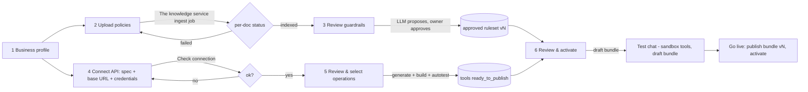
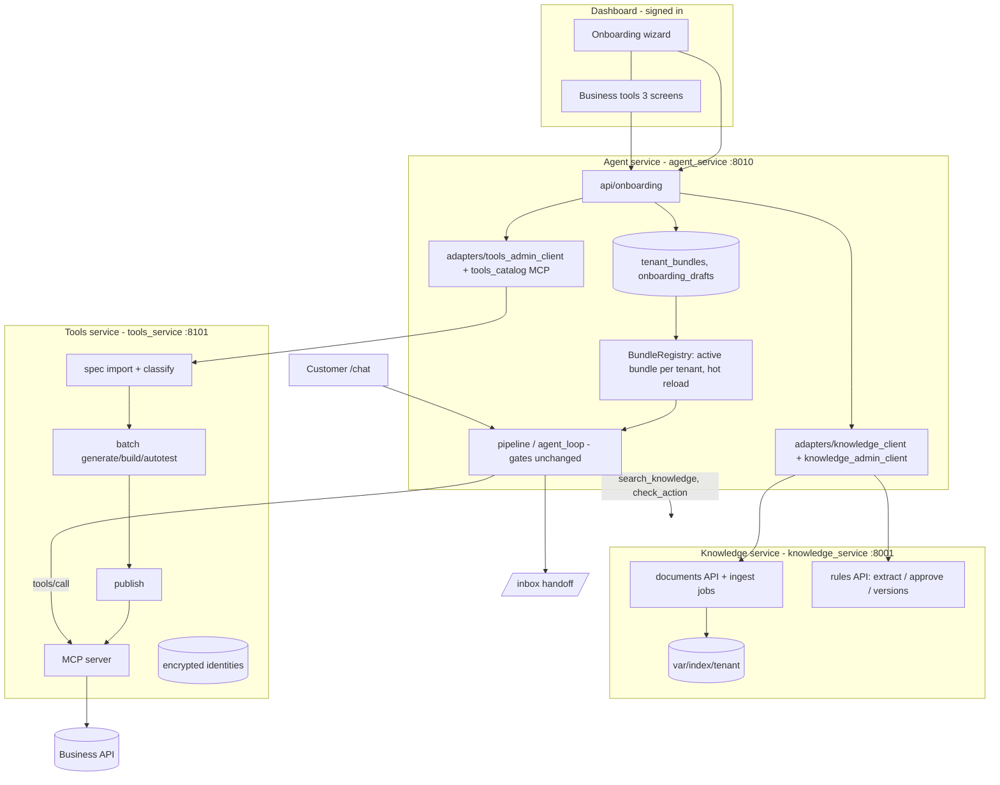
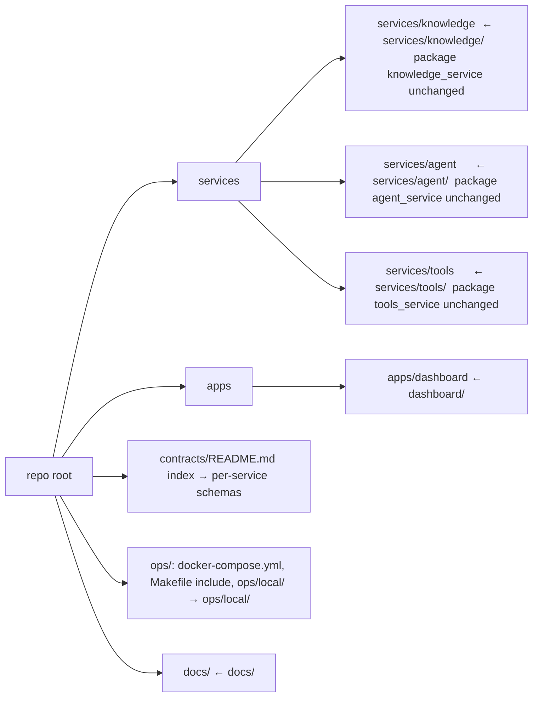

# Ticket-Easy · Master Plan (onboard → knowledge + guardrails → tools → live agent → monitor)

> Approved 2026-10-12. Progress is recorded in `docs/plan/TICKET_EASY_MASTER_PROGRESS.md`.
> Legend: **[E]** exists in code · **[M]** missing · **[A]** assumption to verify at the start of the phase.

## Context
Ticket-Easy works end to end, but it is three products stitched together: a business is added by hand-writing
`services/agent/config/tenants/<t>.json` + fixtures and restarting; policies are ingested by a CLI in the knowledge service; tools are built
in the tools service's own loopback-only pages (5 core screens, ~11–12 required form posts) and bound to the agent through a JSON
file; the UI is dark, inconsistent across Chat/Inbox/Dashboard/the tools service, and shows "The tools service" to users. This plan turns
it into one product with one journey and one light "aurora" UI, phase by phase, each phase shippable on its own.

### Supersedes / relation to older plans
| Document | Status after this plan |
|---|---|
| `docs/plan/Ticket-Easy_Implementation_Plan.md` (the agent product plan, phases 1–6) | Kept as history of the conversation core. Its Flow 1 "Setting up a business" and Phase 6.4 "second business" are **superseded** by P2+P5 here. |
| `docs/plan/TOOLS_AUTOTEST_AND_PRODUCTION_PLAN.md` + `TOOLS_AUTOTEST_PROGRESS.md` | Implemented; kept. P3 **builds on** its autotest/promotion; its open items (§"Still to do") stay out of scope unless listed in P3. |
| `services/tools/docs/OWNER_FLOW_REVIEW.md` (implemented owner-flow refinement) | Its open next steps (`:79-85`) are **superseded** by P3's 3-screen flow. |
| Separate "frontend-redesign" and "workflow-refinement" plans | **No such files exist** in the repo [verified]; this plan is the only one. |

---

## 1. Goal & user journey
| # | Owner sees | Backed by |
|---|---|---|
| 1 | **Business profile**: name, language(s), tone, order-id format, escalation contacts | P5 wizard → P2 bundle draft |
| 2 | **Upload policies** (pdf/docx/md/xlsx/txt/html), per-file status | P4 the knowledge service ingest API |
| 3 | **Guardrails**: rules derived from the policies, each with its quoted source; approve / edit / reject | P4 the knowledge service rules + approval |
| 4 | **Grant data access**: OpenAPI/Swagger URL or file, base URL, credentials once, *Check connection* | P3 Connect/Import |
| 5 | **Choose tools**: operations grouped Read / Write / Risky, select, auto-generate, auto-test | P3 Review & select, Test & publish |
| 6 | **Review & activate**: what was ingested, guardrails approved, tools ready, **test chat**, one **Go live** | P5 + P2 bundle publish |
| 7 | **Live agent** answers customers using the active bundle | The agent pipeline (unchanged gates) |
| 8 | **Monitor**: dashboard, inbox, alerts, roll back a bundle version | existing dashboard + P2 rollback |

---

## 2. Current-state findings

### 2.1 What exists vs. what is missing
| Area | Exists [E] (file refs) | Missing [M] |
|---|---|---|
| Tenant config | `TenantConfig` / `TenantRegistry.from_dir` (`services/agent/src/agent_service/domain/tenant.py:160,195`), files `services/agent/config/tenants/{shop_001,noon_eg}.json`; loaded once at startup | DB-backed config, versioning, hot reload, rollback, any "bundle"; onboarding of any kind |
| Contracts | `services/agent/contracts/schemas/*.schema.json` (17) generated by `scripts/export_schemas.py` (`make schemas`), drift test `tests/unit/test_export_schemas.py` (**skips DashboardAgent, ReplayResult**), CI `schemas` job; dashboard types via `dashboard/scripts/gen-types.mjs`; the knowledge service `services/knowledge/contracts/schemas` (17) via `python -m knowledge_service export-schemas` | Bundle schema; runtime JSON-schema validation (no `jsonschema` lib; `services/agent/src/agent_service/contracts/json_schema.py` is a tool-argument checker only) |
| Tool binding | `ToolsConfig` from `AGENT_TOOLS_CONFIG` JSON (`services/agent/src/agent_service/adapters/tools_catalog.py:116`), environments sandbox/live_demo/production | Binding from a bundle; reload without restart (only list refresh every 60 s) |
| Knowledge ingest | `python -m knowledge_service ingest --tenant X` (`services/knowledge/src/knowledge_service/__main__.py:31`), parsers md/docx/pdf/xlsx (`knowledge/parsers.py:122`), section chunking (`knowledge/index.py:28-49`), bge-m3 via Ollama, flat `.npy` + in-house BM25, `var/index/<tenant>/`, `POST /v1/admin/reload` | HTTP upload/ingest, per-document status, incremental re-index, txt/html, atomic rebuild + lock; tenants outside `data/<category>/<tenant>/` |
| Retrieval | `POST /v1/knowledge/search`, `GET /v1/knowledge/passages` (`services/knowledge/src/knowledge_service/service.py:119,125`), per-tenant index + tenant filter (`knowledge/retrieval.py:362`); eval `python -m knowledge_service eval-retrieval` | **Caller auth** on public endpoints (any caller can query any tenant) |
| Guardrails | `Rule` model (`services/knowledge/src/knowledge_service/schemas.py:146`), LLM `rules extract` → *proposed* only (`policy/extract.py`, verbatim-quote check), approve/reject/patch routes (`service.py:272-306`, X-Admin-Key), guardrail regression on approve (`policy/guardrails.py:67`), deterministic enforcement, approved-only, fail-closed (`policy/check.py:102-183`); the agent gate order + handoff on deny/require_human/unavailable | Rule version history/audit, staleness when a document version changes, ruleset version id, a review UI, extraction prompt for non-e-commerce, rules for `noon_eg` |
| OpenAPI → tools | The tools service: OAS 3.0/3.1-subset parse + per-op validation (`services/tools/tools_service/discovery.py`), upload ≤2 MiB / fetch allow-listed (`services/discovery.py:38-74`), inventory API (`api/businesses.py:64`), signals restricted/review (`discovery.py:517`), risk factors (`compiler/semantics.py:137`), proposals/review/policy, build (`services/building.py:110`), autotest (`autotest.py`, `services/autotest.py`), publication re-check (`services/publication.py:120`), promotion (`services/promotion.py:55`), MCP server (`mcp_server.py`) | Swagger 2.0; apiKey/basic auth in executor (`artifacts.py:41-59` = bearer + OAuth2 password only); **identities stored in plaintext** (`services/connectors.py:239`); one per-op read/write/risky class for the UI; batch flow across operations |
| Tool UI | The tools service Jinja pages (`web/pages.py`, `web/actions.py`, 14 live templates); dashboard `/dashboard/tools` (`dashboard/src/pages/BusinessTools.tsx`, API `services/agent/src/agent_service/api/business_tools.py`) | ≤3-screen flow inside the product (signed in) |
| UI | `services/agent/web/shared/aurora.css` (dark only), chat/inbox static pages (hard-coded EN, inbox untranslated), dashboard React 19 + Recharts 3, EN/AR + RTL (`dashboard/src/i18n`), `styles.css` dark copy of tokens | Light theme, shared header/nav, inbox/chat i18n, consistent states |
| "The knowledge service/B/C" visible | 34 lines in `dashboard/src/i18n/{en,ar}.ts` (`bt.*`), 12 lines in `services/tools/tools_service/web/templates` (e.g. `base.html:6,58`); chat/inbox/shared: 0 | — |
| Repo | `services/knowledge/ services/agent/ services/tools/ dashboard/ ops/local/ docs/`, root `Makefile`, `docker-compose.yml` (no the tools service) | Product layout |
| Dead code | `services/tools/tools_service/web.py`, `services/tools/tools_service/templates/`, `services/tools/.git` (stray local repo, files tracked by the outer repo), shims `storage.py`, `code_discovery.py`, `quality.effects()` no-op | — |

Noted, not fixed by this plan: `AGENT_PLANNING_MODE` defaults to `on` in `services/agent/src/agent_service/config.py:128` while `services/agent/CLAUDE.md` says "default off" (doc drift).

### 2.2 Test commands
| Component | Command (from repo root, PowerShell or Git Bash) | Needs |
|---|---|---|
| The knowledge service | `cd rag; .venv/Scripts/python -m pytest -q` | venv |
| The knowledge service evals | `cd rag; $env:PYTHONPATH="src"; .venv/Scripts/python -m knowledge_service eval-retrieval --tenant shop_001 --split test` · `... eval-guardrails` | built index |
| The agent | `cd orchestrator; .venv/Scripts/python -m pytest -q` (= `make test`) · `make lint` (ruff, format, mypy) · `make scenarios` · SQLite: `AGENT_STORE=sqlite make test` · `make schemas` | venv |
| The tools service | `cd tool_generation_mcp; .venv/Scripts/python -m pytest -q` (or `uv run pytest -q`) | venv (Python 3.13) |
| Dashboard | `cd dashboard; npm test` (vitest) · `npm run typecheck` · `npm run build` (writes `services/agent/web/dashboard`) · verify-only build: `npx vite build --outDir <tmp> --emptyOutDir` | node_modules |
| Stack | `python ops/local/serve.py up` / `status` | all venvs, `services/tools/.env` model provider |
| Integration (real services, change state) | `services/agent/.venv/Scripts/python ops/local/e2e_chat.py` (33) · `e2e_live_chat.py` (22) · `live_demo_check.py` (12) · `autotest_check.py [--fresh]` · `production_check.py --phase promote|bind|chat` · `tools_lifecycle.py --tool <t>` | stack up + lifecycle done + model provider |
| Docker | `docker compose --profile light config` · `make demo` | Docker |

### 2.3 Baseline (run 2026-10-12, before any change)
| Suite | Result | Notes |
|---|---|---|
| The knowledge service pytest | **973 passed**, 1 warning (94 s) | |
| The agent pytest | **3844 passed, 1 failed, 1 deselected** (230 s); reruns: **3845 passed** and **3849 passed** (with the P0 tests), 0 failed | Failure `tests/unit/the core test_b_briefing.py::test_the_transcript_and_trace_ids_come_from_the_stored_traces` is a **random flake, not order-dependent**: `incomplete()` scans the whole package JSON with `FULL_PHONE = 01[0-25]\d{8}` (`services/agent/src/agent_service/handoff/cases.py:318,341`) and the random trace id `dbeee01591394440bf…` contained `01591394440`. Pre-existing; not fixed by this plan (separate task: skip id fields in the scan). |
| The agent `make lint` | **clean** (ruff, format, mypy: 118 files) | |
| The tools service pytest | **671 passed** (498 s) | |
| Dashboard vitest | **51 passed** (6 files) | |
| Dashboard typecheck | **pass** (13 schemas up to date) | |
| Dashboard build | **pass** (into a temp dir; >500 kB chunk warning) | `services/agent/web/dashboard` not touched |
| Integration scripts | **not run** (need full stack + model provider; they mutate state) | last recorded green 2026-10-12 in `TOOLS_AUTOTEST_PROGRESS.md`: e2e_chat 33/33, e2e_live_chat 22/22, live_demo_check 12/12, production_check 21/21 + 15/15 |

A local stack (`serve.py up`) was running during the baseline; unit suites do not depend on it.

---

## 3. Target architecture

### 3.1 Onboarding flow


### 3.2 End-to-end data flow


### 3.3 Target repo layout (P7)


### 3.4 Tenant configuration bundle (P2) — shape
`services/agent/contracts/schemas/TenantBundle.schema.json` (generated from `services/agent/src/agent_service/domain/bundle.py`, same convention as the other schemas):
```
TenantBundle {
  schema_version: "1.0", tenant_id, version:int, status: draft|published|active|retired,
  created_at, created_by, parent_version?, content_sha256,
  config: TenantConfig            # existing model, unchanged = old format embedded as-is
  profile: { display_name, locales[], tone: friendly|formal|neutral, default_locale }
  knowledge: { provider: knowledge_service|simulated, index_tenant, built_at, documents:[{document_id, version, status}] }
  guardrails: { ruleset_version, ruleset_sha256, approved_rule_ids[], violation: {deny:"refuse", require_human:"handoff", unavailable:"handoff"} }
  tools: [{ name, source: tools_service|simulated, binding?: {business_id, proposal_id, environments[]},
            permission: read|confirm|human_only, risk: low|medium|high }]
  escalation: EscalationConfig    # existing model
}
```
Secrets are never in a bundle (credentials live encrypted in the tools service; bundle holds ids only).

---

## 4. Phases

### P0 — Baseline & safety net · size S · deps: none
**Scope:** record baseline, add smoke tests only where later phases need a net. No product change.
- [x] Copy this plan to `docs/plan/TICKET_EASY_MASTER_PLAN.md`; create `docs/plan/TICKET_EASY_MASTER_PROGRESS.md` with §2.3.
- [x] Run `make lint` (the agent) and record.
- [x] Re-run the agent full suite twice to characterise the `test_b_briefing` flake (record seed/order; do not change it here). → random id vs phone pattern, see §2.3.
- [x] Add `services/agent/tests/unit/test_export_schemas.py` coverage for DashboardAgent + ReplayResult (gap found) — test-only.
- [x] Add a static-page smoke test: `/chat`, `/inbox`, `/ui/aurora.css` return 200 and keep their ids/classes used by `chat.js`/`inbox.js` (`services/agent/tests/unit/api/test_static_pages.py`) — the net for P1/P6.
- [x] Add dashboard vitest "renders every route without console errors" (`dashboard/src/test/routes.test.tsx`) — net for P6.
- [x] Optionally (with stack up) run the 4 integration scripts and record; otherwise keep the last recorded values. → **skipped**: they mutate the integration state and need a model provider; last recorded values kept.
**Tests:** (a) the two new tests; (b) schema drift for all 17; (c) none; (d) commands §2.2; (e) **exit:** progress file has baseline; all suites = baseline (+ new tests pass).
**Risks:** none. **Rollback:** delete new test files.

### P1 — Design tokens (light aurora) · size S · deps: P0
**Scope:** tokens + shared component spec only; **visual/copy only**, no ids/classes/routes changed.
- [ ] Add the light token set to `services/agent/web/shared/aurora.css` under `:root[data-theme="aurora-light"]` (opt-in) — palette, glass (`@supports (backdrop-filter)` fallback solid `#FFFFFF`), radii 16–20, shadow, text #0F172A/#475569/#94A3B8, accents teal #0D9488 / magenta #C026D3 / blue #2563EB, status red/amber/green + soft tints, static corner glows (no animation), grain ≤ .04, 2px teal `:focus-visible`, 44px targets ≤768px, `prefers-reduced-motion`.
- [ ] **Colour roles that keep AA** (measured on #FFFFFF / #F8FAFC): #0F172A 17.9 ✓, #475569 7.6 ✓, blue #2563EB 5.2 ✓, red #DC2626 4.8 ✓, magenta #C026D3 4.7/4.5 ✓ — but **muted #94A3B8 2.6 ✗, teal #0D9488 3.7 ✗, amber #D97706 3.2 ✗, green #16A34A 3.3 ✗**. So the spec colours stay for fills, icons, edges, focus ring and large text; text-on-light uses a `-text` token: muted text #64748B (4.8), teal text / primary button fill with white label #0F766E (5.5), amber text #B45309 (5.0), green text #15803D (5.0); #94A3B8 only for placeholders, disabled and borders [D9].
- [ ] Buttons: `.te-btn` primary / secondary(glass) / danger / `[disabled]` / `[aria-busy=true]` loading.
- [ ] Shared component spec (CSS + markup contract, documented at top of aurora.css): `.te-header` (brand, nav, locale switch, user), `.te-brand`, `.te-nav`, `.te-state--empty|loading|error`, `.te-badge--ok|warn|bad` (icon + label).
- [ ] Fonts: Space Grotesk, Inter, IBM Plex Sans Arabic, `display=swap`, `:lang(ar)` font stack.
- [ ] Dashboard: import the same file (`dashboard/src/main.tsx` → `import "../../services/agent/web/shared/aurora.css"` [A: Vite allows the out-of-root import; else a copy step + sync test]) so tokens have **one source**; `styles.css` tokens become aliases.
- [ ] Contrast check script `services/agent/scripts/check_contrast.py` (pure Python, WCAG formula) over the token pairs.
**Why opt-in:** switching `:root` to light now would break pages still written with white-on-dark rgba values; each surface flips `data-theme` when it is restyled (P3 new screens, P5 wizard, P6 rest). Every phase stays shippable.
**Tests:** (a) contrast script: every `*-text` token and button label ≥ 4.5:1 on page, glass and tinted badge backgrounds; non-text accents (icons, focus ring, edges) ≥ 3:1; (b) static-page smoke unchanged; (c) a token preview page `services/agent/web/shared/tokens.html` screenshot desktop+mobile, EN+AR; (d) the agent pytest, dashboard test/typecheck/build; (e) **exit:** no visual change on existing pages with default theme; preview page passes contrast; suites at baseline.
**Risks:** Vite path import; font weight cost. **Rollback:** revert aurora.css block + import.

### P2 — Contracts + tenant configuration bundle + orchestrator consumption · size L · deps: P0
**Scope:** goal 3, backward compatible: files in `config/tenants/` keep working; a published bundle for a tenant takes precedence.
- [ ] `services/agent/src/agent_service/domain/bundle.py`: `TenantBundle` (embeds existing `TenantConfig` and `EscalationConfig`), `content_sha256`, validators (tool names unique; every `config.permissions.allowed_tools` entry present in `tools` or `*`; `human_only` tools never `confirm`; no field named like a secret).
- [ ] Export `TenantBundle.schema.json` via `scripts/export_schemas.py`; add to drift test; fixtures `services/agent/tests/fixtures/bundles/{valid_minimal,valid_shop_001,invalid_*}.json`.
- [ ] Add `jsonschema`? **No** — validate with the Pydantic model (source of truth) + drift test; schema file is the published contract (no new dependency).
- [ ] Migration `services/agent/src/agent_service/adapters/migrations/007_tenant_bundles.sql` [A: CLAUDE.md says "005+ ask first" → **open decision D6**]: `tenant_bundles(tenant_id, version, status, content_json, content_sha256, created_at, created_by, parent_version)`, `tenant_bundle_active(tenant_id, version, activated_at, activated_by)`; memory-store twin.
- [ ] `ports.BundleStore` + `adapters/memory_store.py` / `sqlite_store.py` implementations.
- [ ] `BundleRegistry` (wraps `TenantRegistry`; same `get/tenant_ids/__contains__` API): active bundle's `config` > file config; `reload(tenant_id)` swaps atomically; container exposes it as `container.tenants` so the core is unchanged (rule 8).
- [ ] `tools_catalog.TenantState`: accept bindings from the bundle `tools[].binding` (file config still read; bundle wins per tenant); reload re-creates MCP sessions for that tenant only.
- [ ] `bundle_from_files(tenant_id)` importer: builds v1 of `shop_001`/`noon_eg` from existing files (proves old→new).
- [ ] API (`services/agent/src/agent_service/api/bundles.py`, manager read / admin write, CSRF; routes default to admin in `api/auth.py`, so the manager reads need `ROLES` entries): `GET /v1/admin/tenants/{t}/bundles`, `GET .../bundles/{v}`, `POST .../bundles` (create draft), `POST .../bundles/{v}/publish`, `POST .../bundles/{v}/activate` (hot reload), `POST .../bundles/{v}/rollback` (= activate parent), `GET .../bundles/active`.
- [ ] Traces: `versions.tenant_config_hash` = bundle `content_sha256` + `bundle_version` (existing versions dict).
- [ ] CLI: `python -m agent_service bundle import|export|activate --tenant X`.
**Tests:** (a) model valid/invalid fixtures; sha stable; secret-name guard; (b) schema drift incl. TenantBundle; registry precedence (file only / bundle only / both); version increments; publish immutability; activate → next turn uses new config without restart; rollback; concurrent activate (SQLite); orchestrator runs the shop_001 scenario set with **file config and with the imported bundle → identical decisions** (`make scenarios` both ways); (c) none; (d) `make test`, `AGENT_STORE=sqlite make test`, `make lint`, `make scenarios`, `make schemas` + git diff; dashboard typecheck; e2e_chat with a bundle-activated shop_001; (e) **exit:** all old tests green, scenarios identical in both modes, bundle CRUD/rollback tested.
**Risks:** silent behaviour change via precedence → scenario parity test; MCP reload races → per-tenant lock. **Rollback:** no bundle active ⇒ file path; feature flag `AGENT_BUNDLES` (default **off** until the P2 exit criteria pass, then on; `0` always falls back to the files).

### P3 — Swagger/OpenAPI → tools, collapsed to 3 screens · size L · deps: P1, P2
**Scope:** goals 4, 5. Reuse the tools service's internal services; add a batch orchestration and the three dashboard screens (styled with P1 tokens, `data-theme="aurora-light"`).

Backend — the tools service (`services/tools/tools_service`):
- [ ] `discovery.py`: Swagger 2.0 → OAS 3.0 in-house converter (`swagger2.py`, stdlib only: host/basePath/schemes→servers, definitions→components, body/formData params→requestBody, securityDefinitions→securitySchemes) [D2].
- [ ] Partial specs: invalid operations listed with `technically_unsupported` + reason (exists per-op) — surface counts; URL import stays limited to `OPENAPI_FETCH_HOSTS` (SSRF guard; the screen says "upload the file instead" for other hosts); large specs: raise upload limit 2→10 MiB (setting), inventory API paginated (`?offset&limit`), parse once and cache (exists `discovery_cache`).
- [ ] `classify.py`: one `operation_class(op) -> read | write | risky | restricted` combining `SAFE_METHODS`, signals (`discovery.py:517`), risk factors (`compiler/semantics.py:137`); returned in inventory API.
- [ ] Auth: executor supports `apiKey` (header/query) and HTTP `basic` besides bearer + OAuth2 password (`artifacts.py:41`); multiple schemes → owner picks one per connector; no-auth APIs allowed (exists).
- [ ] Secrets: encrypt identity secrets at rest with Fernet (`cryptography` already installed in tool_generation_mcp venv via `mcp`/`pyjwt`; **pin it** in `pyproject.toml`), key from `TOOLS_SECRET_KEY` (env or `file:`), migration 10 re-encrypts existing rows; redaction of secret fields in every API response, log line, diagnostics and error (`secret_redaction` test).
- [ ] Batch API `POST /api/v1/businesses/{bid}/tool-batches {spec_id, operation_ids[], verify_operation_id?}` → per operation: generate proposal → apply suggested access policy + suggested answers → reconcile → state `needs_owner` with a short summary (what it does, class, inputs, effect flags) ; `POST /tool-batches/{id}/approve {proposal_ids[], confirmations}` → decision approve (recorded owner) → build → autotest (sandbox) → `ready_to_publish`; `POST /tool-batches/{id}/publish` → publish sandbox. Write tools require owner to confirm the four effect flags (`compiler/readiness.py:18`) — prefilled, never auto-accepted.
Backend — the agent:
- [ ] `tools_admin_client.py`: spec upload/fetch, inventory, connectors save + identity (credentials forwarded once, never stored/logged in the agent), batch calls.
- [ ] `api/business_tools.py`: `POST .../import` (file|url), `GET .../operations`, `POST .../connection` + existing `.../connectors/{id}/check`, `POST .../batches`, `POST .../batches/{id}/approve`, `POST .../batches/{id}/publish` → writes `tools[].binding` into a **new draft bundle** (P2) and activates only on explicit owner action.
Frontend — dashboard:
- [ ] `/dashboard/tools` (overview, kept) + `/dashboard/tools/connect`, `/dashboard/tools/review`, `/dashboard/tools/publish` (`pages/tools/{Connect,Review,Publish}.tsx`); short copy, one primary action per screen, technical detail under "Details"; EN+AR.

**Tool flow before → after**
| Step | Before (the tools service pages) | After (dashboard) |
|---|---|---|
| Create business | home form | auto (tenant ↔ business created on first import) |
| Upload/fetch spec | business page | **Screen 1 Connect/Import** |
| Connector + base URL | proposal page (build section) | Screen 1 |
| Credentials / identities | artifact page | Screen 1 (once, encrypted) |
| Check connection | artifact page | Screen 1 |
| Inventory / areas / request a tool (AI) | inventory + business + live page | **Screen 2 Review & select** (grouped Read/Write/Risky, select) |
| Suggest access, accept policy, answers, reconcile, confirm requirement | proposal page (5–6 posts) | Screen 2: prefilled by batch; owner confirms per tool (writes: effect flags) |
| Approve to build, build | proposal page | Screen 2 "Approve selected" (builds) |
| Fixtures / test identities, auto-test | artifact page | **Screen 3 Test & publish** (autotest runs automatically) |
| Publish | artifact page | Screen 3 "Publish" → draft bundle |
| Bind in the agent (JSON file, restart) | manual | Screen 3 → bundle activate (hot reload) |
| **Required posts** | ~11–12 (15–20 with helpers) | **≤ 5** (import, connect, check, approve selected, publish) |

**Route disposition** (nothing removed in P3; old URLs keep working)
| Route | Disposition |
|---|---|
| The agent `/dashboard/tools` | **keep** (overview; links to the 3 screens) |
| The tools service `/` | **keep**, banner "Advanced view — use the dashboard"; `TOOLS_PRODUCT_URL` set ⇒ **redirect** 302 to `/dashboard/tools/connect` |
| The tools service `/businesses/{bid}` | **keep** as advanced (linked under Details) |
| The tools service `/specifications/{sid}` | **merge** into Screen 2; page kept, linked under Details |
| The tools service `/proposals`, `/proposals/{pid}` | **keep** (Details: full review) |
| The tools service `/artifacts/{aid}` | **keep** (Details: tests, production promotion read-only) |
| The tools service `/runs/{rid}`, `/live/{jid}` | **keep** |
| The tools service `POST /actions/*`, `/api/v1/*` | **keep** (used by `ops/local/tools_lifecycle.py`, the agent admin) |
| Retired `local_project`, `code_analysis` | already 410 — keep |
**Tests:** (a) spec fixtures under `services/tools/tests/fixtures/specs/`: valid OAS 3.0, 3.1, Swagger 2.0, malformed JSON/YAML, duplicate keys, huge (generated 5k ops, time bound), no-auth, multiple schemes, partial (some invalid ops), external `$ref`; classification table test; apiKey/basic executor tests; encryption round-trip + migration + `grep` that no secret appears in responses/logs; batch service tests with model substitutes; (b) the agent adapter/API tests with `fake_tools_mcp.py` + a fake admin; bundle draft written on publish; autotest against the Nile sandbox via `autotest_check.py`; old routes return 200/302 (`test_web_layer.py` extended); (c) vitest for the 3 screens (loading/empty/error, RTL), screenshots desktop+mobile; (d) the tools service/the agent/dashboard suites, `ops/local/tools_lifecycle.py --fresh --tool order`, `e2e_chat.py`, new `ops/local/tools_flow_check.py` (3-screen API path end to end on the sandbox); (e) **exit:** a fresh sandbox business gets order + ticket tools published from the 3 screens with ≤5 posts; all old routes work; no plaintext secret at rest; suites ≥ baseline.
**Risks:** model variance in batch generation → per-tool `needs_owner` + retry, never auto-approve; encryption migration → backup DB first (`services/tools/data/backups`). **Rollback:** screens are additive; disable via feature flag; migration 10 has a decrypt-back script.

### P4 — RAG ingestion + guardrails (derive, review, enforce) · size L · deps: P2 (bundle), P1 (UI)
The knowledge service (`services/knowledge/src/knowledge_service`):
- [ ] Tenant registry for onboarded tenants: `var/tenants/<tenant>/{corpus,manifest.json,rules.json}` beside the shipped `data/<category>/<tenant>/` [A: category default `e-commerce`].
- [ ] Documents API (X-Admin-Key): `POST /v1/admin/tenants/{t}/documents` (multipart, size/type limits), `GET .../documents` (status `uploaded|parsing|indexed|failed` + error), `DELETE .../documents/{id}` (marks not current), `POST .../reindex` (background job, build into a temp dir then atomic rename, per-tenant lock), `GET /v1/admin/jobs/{id}`.
- [ ] Parsers: `.txt`, `.html` (stdlib `html.parser`, no new deps).
- [ ] Caller auth: `X-Service-Key` required on `/v1/knowledge/*` and `/v1/policy/*` when `SERVICE_API_KEY` is set; the key is bound to an allowed tenant list [D4]. The agent: `knowledge_client.py` sends it from a new `AGENT_KNOWLEDGE_KEY` (added to `.env.example`, whose completeness a test checks); `ops/local/serve.py` generates the key into `ops/local/var/` like the other local secrets.
- [ ] Rules: `POST /v1/admin/tenants/{t}/rules/extract` (job; existing `policy/extract.py`, vocabulary per category), rule versions table/file (`rules_history.jsonl`: who/when/what), `ruleset_version` = sha of approved rules, `GET /v1/policy/rules/ruleset?tenant_id=`; rules whose source document version is no longer current → status `stale` (not enforced, shown for review).
The agent:
- [ ] `adapters/knowledge_admin_client.py` (HTTP) + simulated equivalent in `adapters/simulated/` (tests never need the knowledge service).
- [ ] `api/knowledge.py` (manager): documents upload/list/reindex, guardrails list/approve/reject/edit (proxy, signed-in reviewer name recorded — not self-reported).
- [ ] Bundle `knowledge` + `guardrails` sections filled from the knowledge service; publishing a bundle **requires** `guardrails.ruleset_version` to equal the knowledge service's current approved ruleset.
- [ ] Violation behaviour (existing gates, made explicit + tested): deny → refuse with the rule's `user_message` + citation; require_human → handoff `approval_required`; the knowledge service unreachable / timeout / malformed → handoff `dependency_unavailable` (fail closed, exists); unapproved/stale rule → ignored by enforcement.
Dashboard: `/dashboard/knowledge` (documents with status, re-index) and `/dashboard/guardrails` (rule card: quote + source, effect, approve/edit/reject).
**Tests:** (a) ingestion per type (md, docx, pdf, xlsx, txt, html) incl. corrupt file → `failed` with reason; re-index replaces atomically; status transitions; (b) **tenant isolation**: tenant A's key/queries never return tenant B passages (search, get_passage, past tickets); unknown key → 401; retrieval eval on fixture docs (`eval-retrieval` recall@5 ≥ current baseline for shop_001/noon_eg); extraction fixtures (model substitute → proposed rules; verbatim-quote rejects); **"unapproved guardrail is not enforced"**; stale rule not enforced; violation → refuse/handoff scenarios added to `services/agent/scenarios/shop_001` (CLAUDE.md rule); the knowledge service down → handoff; (c) vitest for both pages (states, RTL); (d) the knowledge service pytest + evals, the agent `make test`/`make scenarios`/`make lint`, dashboard, `e2e_chat.py` (the knowledge service with service key); (e) **exit:** a new tenant can upload docs, see statuses, approve rules, and the agent answers with citations from that tenant only.
**Risks:** LLM extraction quality → human approval mandatory; index rebuild on big corpora → background job. **Rollback:** new endpoints additive; auth off when `SERVICE_API_KEY` unset.

### P5 — Onboarding wizard · size M · deps: P2, P3, P4
- [ ] Migration `008_onboarding_drafts.sql` [D6]: `onboarding_drafts(tenant_id, step, data_json, updated_at, updated_by)` — ids and statuses only, **no secrets** (validator + test).
- [ ] `api/onboarding.py`: `POST /v1/onboarding` (create tenant draft, idempotent on name→tenant_id), `GET /v1/onboarding/{t}` (resume), `PUT .../profile`, step endpoints compose P4 (documents, guardrails) and P3 (import/connect/batches) — every POST idempotent via `Idempotency-Key` header or natural keys.
- [ ] Tenant generation: profile + chosen tools → `TenantConfig` draft: identity `verify_tool` = the operation the owner marks "verifies a customer" [A]; intents generated per tool (read → `lookup`, write → `action`, `argument_map slot:<field>`); new tenants run with `agent_mode: on` (needs an LLM) [D3].
- [ ] Review & activate screen: counts (documents indexed/failed, rules approved/pending, tools ready), blockers list, **Test chat** (embedded `/chat?tenant_id=<t>&preview=<signed token>`: uses the draft bundle, sandbox tools only, manager-only token, traces marked `preview`), **Go live** = publish + activate bundle (P2). Before Go live the public chat answers `TENANT_NOT_LIVE` (new code in the error envelope, 404; add it to the code list in `services/agent/CLAUDE.md`).
- [ ] `dashboard/src/pages/onboarding/*` (stepper, resumable from URL + server draft), light theme.
**Tests:** (a) draft validator (no secrets), tenant/intents generator unit tests; (b) wizard API e2e in-process (simulated services + fake the tools service): **happy path, resume after reload, idempotent re-submit, upload failure, bad spec, connection-check failure, Go live blocked until test chat run + rules approved**; preview chat uses draft bundle and cannot reach live tools; (c) vitest per step (loading/empty/error), RTL, keyboard; screenshots; (d) all suites + `ops/local/onboarding_check.py` (new; real stack, sandbox, fresh tenant `demo_onb`); (e) **exit:** a fresh business reaches Go live from the wizard only and a customer message is answered with its citations and its sandbox tool.
**Risks:** generated intents quality → agent mode + gates; tenant id collisions → slug + suffix. **Rollback:** wizard additive; tenant stays draft.

### P6 — Restyle & unify remaining surfaces · size M · deps: P1 (and P3–P5 screens already light)
**Visual/copy only** — no ids, classes used by JS/tests, routes, form names, data-attributes changed (P0 smoke test guards it).
- [ ] Chat (`services/agent/web/chat`): centered ~720px, customer right teal, AI left glass, human agent left magenta + badge, typing indicator (exists "pending" bubble → restyle), error banner, dev details collapsed; chrome strings EN/AR via a small `i18n.js` (+ `dir`), `dir="auto"` on messages and inputs.
- [ ] Inbox (`services/agent/web/inbox`): sticky bar, filters, case list badges, urgent red inline-start edge, transcript first then facts/tabs, composer bottom, mobile list→detail with back; EN/AR.
- [ ] Dashboard: `Layout.tsx` sidebar with icons + alert badge, collapses on mobile; identical top bar (business filter, date range, EN/AR, refresh, user); 6 KPI cards from the **existing** `DashboardOverview` fields: conversations, automation_rate, escalation_rate, unverified_results, p95_latency_ms (each has `previous` + `change` → trend) and open_cases (no previous value → trend "—"); "—" for any missing value; agent cards; Recharts recolor (#E2E8F0 grid, legends, tooltips); tables → card lists ≤768px; skeleton/empty/error via `components/Async.tsx`.
- [ ] Remaining Business Tools pages: short copy, next action, details collapsed.
- [ ] Remove visible "The knowledge service/B/C": `dashboard/src/i18n/{en,ar}.ts` `bt.*` values ("tool service", "tool builder"), the tools service templates (`base.html`, `home.html`, `business.html`, `artifact.html`) display text → "Ticket-Easy tools"; the tools service base gets the light tokens (copied file + sync test). Keys, `source: "tools_service"` values, module names untouched.
- [ ] Flip `data-theme="aurora-light"` on every surface; then make light the `:root` default and delete the dark block (last step of P6).
**Tests:** (a) vitest new states, i18n key parity (exists in `shell.test.tsx`); node tests for `inbox.js` helpers unchanged; (b) static smoke (P0); (c) a search for the old letter names over `dashboard/src/i18n services/agent/web/chat services/agent/web/inbox services/agent/web/shared services/agent/data/locales services/tools/tools_service/web/templates dashboard/index.html` → **0 hits**; EN/AR/RTL/mixed text; keyboard focus order; 44px targets (computed-size check in browser); desktop + mobile screenshots of Chat, Inbox, each dashboard page, Onboarding, Business Tools; console free of errors; (d) all suites, dashboard build, `e2e_chat.py`; (e) **exit:** grep clean, screenshots reviewed, suites ≥ baseline.
**Rebuild command:** `cd dashboard; npm run build` (→ `services/agent/web/dashboard`; never edit that folder).
**Risks:** inbox.js selectors → smoke test; chart readability. **Rollback:** per-surface revert of CSS/markup.

### P7 — Repo restructuring · size L · deps: P0–P6 green
Small reversible steps; each ends with: import check, all suites, `docker compose --profile light --profile live config` + `docker compose build`, `make -n demo`, `python ops/local/serve.py status`, docs link check (`scripts/check_links.py`, new, stdlib).
- [ ] 7.1 Display-only: root `README.md` product framing (Knowledge / Agent / Tools services), docs titles; no paths change.
- [ ] 7.2 `Docs/` → `docs/` (case-only rename: on Windows `git mv Docs docs-tmp` then `git mv docs-tmp docs`; update links in READMEs, CLAUDE.md files and `.github/workflows/{ci,safety,eval}.yml`).
- [ ] 7.3 `dashboard/` → `apps/dashboard/` (vite `outDir` → `../../services/agent/web/dashboard` then later services path; Dockerfile node stage; CI paths; gen-types schema path).
- [ ] 7.4 The three service folders move under `services/` (knowledge, agent, tools), one per step; **package names, env vars, routes unchanged**; shims: `serve.py` path table (`SERVICE_FOLDERS`/venv lookup), Dockerfiles `COPY`, compose `build.context`, root Makefile, CI workflows, `.gitignore`, CODEOWNERS; venvs recreated (they are not movable on Windows) [D5].
- [ ] 7.5 `ops/local/` → `ops/local/` with a `ops/local/` shim README pointing to it (scripts use `ROOT` relative paths: update `parents[1]`→`parents[2]`).
- [ ] 7.6 `contracts/README.md` index linking each service's schemas (no file duplication).
- [ ] 7.7 Cleanup: remove `services/tools/.git` (after confirming nothing needed — it has no remote), dead `services/tools/tools_service/web.py`, `services/tools/tools_service/templates/`, compat shims, scratch DBs in `services/tools/data/` (list first, ask before deleting).
**Repo mapping**
| From | To | Kind | Path/import changes |
|---|---|---|---|
| `services/knowledge/` | `services/knowledge/` | physical move | Dockerfile COPY, compose, serve.py, CI, docs; Python imports unchanged |
| `services/agent/` | `services/agent/` | physical move | same + `vite outDir`, `Settings` paths are `PROJECT_ROOT`-relative (unchanged), Makefile `-C` |
| `services/tools/` | `services/tools/` | physical move | serve.py, `agent_service` MCP `server_command` cwd in binding/config (`tools_catalog.py:147`) |
| `dashboard/` | `apps/dashboard/` | physical move | vite outDir, gen-types schema dir, Dockerfile node stage |
| `ops/local/` | `ops/local/` | physical move | `ROOT` depth, docs, `.gitignore` `ops/local/var` |
| `docs/` | `docs/` | physical move | links |
| `docker-compose.yml`, `Makefile` | stay at root (ops entry points) | none | paths inside updated |
| "The knowledge service/B/C" in docs | "Knowledge/Agent/Tools service" | display-only | none |
**Risks:** highest of the plan (Windows path case, venvs, CI). **Rollback:** each step is one commit; `git revert`.

---

## 5. Open decisions (recommendation first)
Pending your confirmation (nothing past P0 is implemented).
| # | Decision | Recommendation |
|---|---|---|
| D1 | Where the 3 tool screens + wizard live | **Dashboard (React, signed in, i18n)** calling the agent, which proxies the tools service REST; the tools service Jinja pages become "Advanced/Details". |
| D2 | Swagger 2.0 | **In-house stdlib converter to OAS 3.0** (no new dependency); unsupported bits listed per operation. |
| D3 | NLU for newly onboarded businesses | **Agent mode required (LLM)** for wizard-created tenants; rules-only NLU stays for shop_001/noon_eg. |
| D4 | The knowledge service tenant isolation | **Service key per caller bound to tenants**, required when configured; off by default for local dev, on in Docker/serve.py. |
| D5 | P7 depth | **Do 7.1–7.3 + 7.6–7.7 first; physical service moves (7.4–7.5) only after a go/no-go at that point** — highest risk, mostly cosmetic. |
| D6 | New the agent migrations 007 (bundles) / 008 (drafts) — CLAUDE.md "005+ ask first" | Approve both numbers now. |
| D7 | Secret storage in the tools service | **Fernet with `cryptography` (already installed transitively; pin it)**, key by env/file reference; production keeps `secret_ref`. |
| D8 | Light theme rollout | **Opt-in `data-theme` per surface, flip default at end of P6** (keeps each phase shippable). |
| D9 | Spec colours that fail AA as text (muted, teal, amber, green) | **Keep them for fills/icons/edges; use darker `-text` tokens for text and button fills** (#64748B, #0F766E, #B45309, #15803D). Alternative: you change the palette. |

## 6. Risks & mitigations
| Risk | Mitigation |
|---|---|
| Bundle precedence silently changes behaviour | scenario parity file-vs-bundle; flag `AGENT_BUNDLES` |
| LLM-derived rules/tools wrong | always `proposed` → human approval; write effect flags owner-confirmed; failures → handoff |
| Secrets leak in drafts/bundles/logs | validators reject secret-like fields; redaction tests; encrypted at rest |
| Cross-tenant retrieval | service keys bound to tenants + isolation tests |
| Pre-existing flake masks regressions | cause recorded in P0 (random id vs phone pattern); compare by test id, not count; rerun a lone failure of that test once |
| Integration scripts mutate state | back up `ops/local/var/` before runs (existing practice) |
| P7 breaks tooling | one move per commit, full checklist after each |

## 7. Out of scope
Real external production API, per-customer OAuth, `output_rows_match_context` for list tools (open items of the autotest/production plan); the tools service in docker-compose; telecom tenant onboarding content; renaming Python packages, env vars, API routes; replacing the vector store; changing safety-critical gate order (`actions/flow.py`, `domain/actions.py`, `agent/loop.py`).

## 8. Verification (per phase, summary)
Each phase ends with: its own tests listed above; the pytest of the three services ≥ baseline (by test id; the known `test_b_briefing` flake tracked); `make lint`; dashboard `npm test`, `npm run typecheck`, verify-only build; for UI phases screenshots desktop/mobile EN/AR via the browser pane against `serve.py up`; integration scripts relevant to the phase (`e2e_chat.py` always for P2–P5). Results + changed files go to `docs/plan/TICKET_EASY_MASTER_PROGRESS.md`; stop for review.
