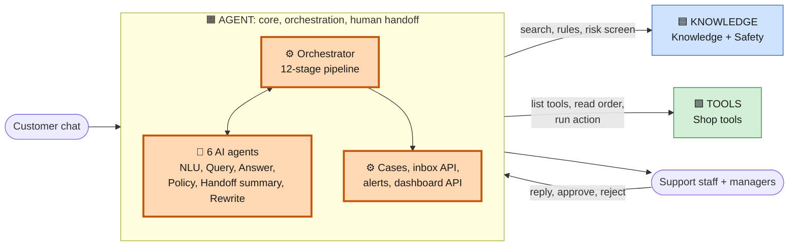
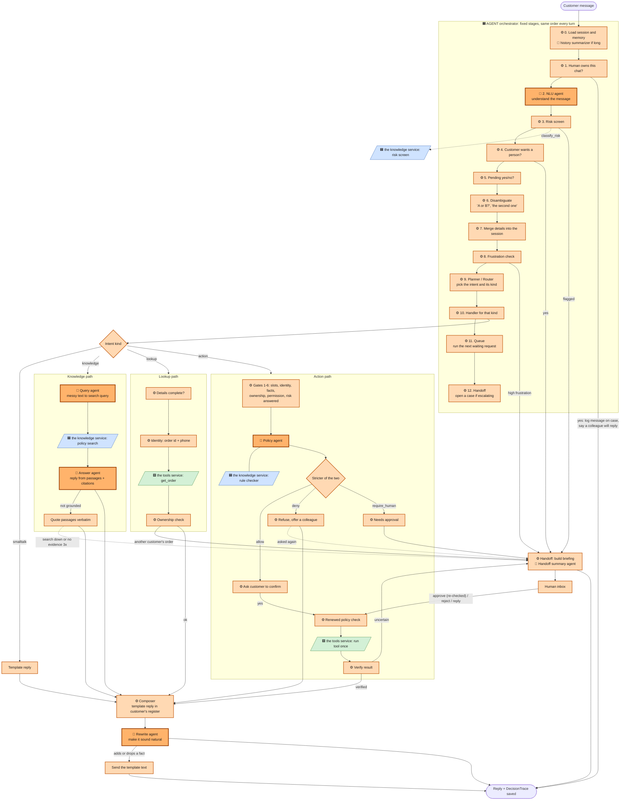
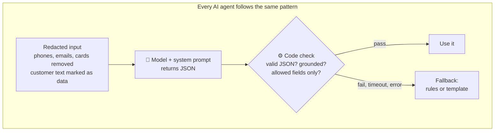
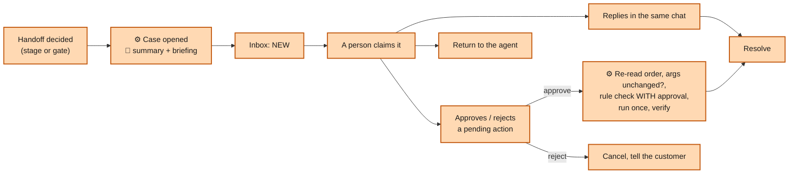

# Ticket-Easy: full workflow, with the agent highlighted

Written for: teammates and reviewers who need to understand how a customer message moves through the whole system and which parts the agent owns.

**How to read the colours** (diagrams) and **markers** (text):

| Marker | Meaning |
|---|---|
| 🟧 **AGENT** | Built by the agent (`services/agent/`): the agent core, orchestration and human handoff |
| 🟦 the knowledge service | Knowledge search (RAG), rule checker, risk screen (`services/knowledge/`) |
| 🟩 the tools service | Tool builder and shop actions (`services/tools/`) |
| 🤖 | An **AI agent**: calls the language model with a system prompt |
| ⚙️ | Plain code, no model call |

---

## 1. The big picture

Ticket-Easy is a customer-service agent for online shops. Customers write in English, Egyptian Arabic, mixed Arabic-English, or Arabizi. The agent answers from the shop's own policies, looks up orders, performs actions (refund, return, cancel...) inside limits the shop sets, and hands over to a person with a full briefing whenever it should.

Three services each own one slice:

- 🟦 **The knowledge service** answers *"what does the policy say?"* (cited passages) and *"is this allowed?"* (allow / deny / require_human) and *"is this message risky?"*. It never talks to the customer and never runs tools.
- 🟧 **The agent** is the **core**. It reads each message, decides what to do, talks to the customer, calls the knowledge and tools services, and passes hard cases to people.
- 🟩 **The tools service** discovers the shop's tools from its API description, lets the owner approve them, and executes actions.



In `AGENT_BACKENDS=live` the agent calls the knowledge service over HTTP. Otherwise the agent uses its own simulated services (demo shop "Nile Style", tenant `shop_001`) so it can run alone. The agent never imports code from the knowledge service or C.

---

## 2. Setting up a business (once, then when policies change)

| Step | Owner | What happens |
|---|---|---|
| Upload policies, FAQ, tariffs | 🟦 the knowledge service | Documents (PDF, Word, Excel, Markdown) are parsed, split into passages and indexed. A newer version of a document supersedes the old one. |
| Propose rules | 🟦 the knowledge service | Rules like "refunds within 14 days" are proposed from the policies. Nothing is enforced until a person approves. |
| Upload API description | 🟩 the tools service | Tools (look up an order, create a return...) are proposed, reviewed by the owner and published. Risky tools default to needing a person. |
| Business settings | 🟧 **The agent** | `config/tenants/<tenant>.json`: languages, intents (with kinds), escalation limits and priorities, alert thresholds. Adding a business needs **no core code change**. |
| Locale texts and lexicon | 🟧 **The agent** | `data/locales/{en,ar,arabizi}` reply templates (62 keys, same keys everywhere) and `data/lexicon`. |

---

## 3. Workflow of one customer message



Every turn ends in **exactly one outcome**: `answer`, `clarify`, `verify_identity`, `confirm`, `execute`, `refuse` or `handoff`. The reason is stored in a **DecisionTrace**.

Darker orange = 🤖 AI agent. Lighter orange = ⚙️ the agent code. Blue = the knowledge service. Green = the tools service.

---

## 4. The 12 stages in detail (🟧 the agent, `turn/stages.py`)

The **orchestrator** (`turn/handler.py`, `turn/pipeline.py`) runs these stages in this order. A stage that decides the outcome (for example a handoff) stops the later stages from deciding anything else. It then composes the reply in the customer's locale, validates the trace invariants, and stores the trace and the session. If the session was changed by another request meanwhile, the turn is retried once.

| # | Stage | What it does | Can it end the turn? |
|---|---|---|---|
| 1 | `handed_off_check` | If a person owns the conversation, the message is added to the case. The customer is told once that a colleague will reply. The agent stays quiet after that. If the case is closed, the agent resumes. | Yes (silent handoff) |
| 2 | `understand` | 🤖 NLU agent reads the message: language, intents, entities (order id, phone, item, reason, amount), yes/no, wants a person, frustration, safety flags. Never stops the turn. | No |
| 3 | `risk_screen` | Asks the knowledge service's risk screen. Fraud, legal, medical or abuse means handoff now. If the screen cannot answer, this is recorded and **actions stay blocked** (fail closed). | Yes (`mandatory_risk`) |
| 4 | `human_request` | The customer asked for a person. | Yes (`customer_request`) |
| 5 | `pending_confirmation` | A yes/no to something the agent asked. A different topic cancels the pending action. | Yes |
| 6 | `disambiguate` | Resolves "do you mean A or B?" (tenant `conflicting_intents` within 0.1 confidence), ordinal choices ("the second", "el awel", "الأول"), and "which order?" (a verified customer without an order id is shown up to 3 masked open orders). | Maybe |
| 7 | `merge` | Stores new details in the session and queues extra intents when the customer asks for several things. Parks an action if a policy question comes first. | No |
| 8 | `frustration` | High frustration with the tenant flag on means handoff. | Yes (`high_frustration`) |
| 9 | `plan` | **Planner / Router.** Pure code: picks small talk, the intent in progress, or nothing to work on. Returns the intent's *kind*. | No |
| 10 | `handler` | Runs the handler for the kind: `smalltalk`, `knowledge`, `lookup`, `action`, `handoff`. No intent means ask to rephrase, refuse as out of scope, or give up after repeated clarifications (`low_confidence`). | Yes |
| 11 | `queue` | After a completed request, runs the next queued one, up to `AGENT_QUEUE_MAX_RUNS` per turn. | No |
| 12 | `handoff` | If a stage chose to escalate, opens the case with a briefing and priority. | Finishes |

**Note on naming:** there is an *orchestrator* (the pipeline) and a *planner/router* (stage 9 plus the handler lookup in stage 10). Both are plain code. No model decides the route or picks a tool.

---

## 5. The three paths in detail

### 5a. Knowledge path (policy questions)

1. 🤖 **Query agent** turns the message and recent history into one standalone search query (English plus key Arabic words, Arabizi understood, no ids or names).
2. 🟦 **The knowledge service** policy search returns passages with citations. One retry with a normalized query for mixed or Arabizi text. Results are cached for 60 s per (tenant, query).
3. 🤖 **Answer agent** words a direct answer from those passages only, in the customer's register, and names the passages it used.
4. ⚙️ Code checks the answer (`check_grounded`). If it adds a number, date, id, amount or link that the passages do not contain, or cites a passage that was not retrieved, the passages are **quoted verbatim** instead. Passages are always shown underneath with their citations.
5. Nothing found: ask the customer to rephrase, then say honestly it is not in the policies and offer a person. The **third time in a row** (`no_evidence`) it is a handoff. If the search service is down after one retry the handoff reason is `dependency_unavailable`.

### 5b. Lookup path (order status)

Details complete, then **identity** (`verify_tool` with order id plus the phone on the order; attempts are counted, a wrong phone is dropped, `identity_failed` handoff at the limit), then `get_order` through the 🟩 the tools service tool (one retry, every attempt recorded), then **ownership**. Another customer's order, or a missing one, is a handoff `ownership_mismatch` with **no data revealed**. The status text comes from templates; a policy quote is added when the tenant says so. Repeated tool failures end in `repeated_tool_failure`.

### 5c. Action path (refund, return, exchange, cancel, change address, voucher, complaint)

The gate order is fixed (`actions/flow.py`, `actions/permissions.py`). If any gate cannot run, **no side effect happens** and the case goes to a person.

1. Required slots (order id, phone, item, reason, amount...)
2. Identity verified
3. Facts loaded from a read tool (facts beat what the customer said)
4. Ownership
5. Permission (tool enabled, not human-only, allowed for this tenant)
6. Risk screen answered this turn
7. **Policy check:** 🤖 Policy agent and 🟦 rule checker, the **stricter wins**
8. Customer confirmation (or human approval)
9. Renewed policy check with fresh data
10. Execute the tool **once**, with a do-it-once key
11. Verify the result: success, audit id, required output fields, reference id for creates

Other rules: writes are never retried automatically (uncertain outcome becomes `unverified_result`); "done" is only said after verification; a person can **never** turn a policy deny into an execution. A first non-final deny is a polite refusal with an offer; asking again becomes a handoff `policy_denied`.

---

## 6. The AI agents (🤖)

Each agent is **one model call with a fixed system prompt**, then a code check, then a fallback. None of them loops, picks tools or plans. Prompts live in `services/agent/prompts/` and the file name is the version recorded on every trace.



### 6.1 NLU agent: "what does the customer mean?"
| | |
|---|---|
| Stage | 2 `understand` |
| Prompt | `nlu_v2.md` |
| Code | `understanding/ai_reader.py` (rule floor in `understanding/rules.py`) |
| Switch | `AGENT_LLM` (model backend: Ollama, OpenRouter, or any OpenAI-compatible endpoint) |
| Input | Customer message, recent history, the tenant's intent catalog (phones, emails, cards removed) |
| Output | Language, intents (in order), entities, `wants_human`, `frustration` (low/medium/high), `safety_flags`, `affirmation` (yes/no), `reason` |
| Code checks | Intents not in the catalog are dropped. Order id and phone from patterns win over the model, and any detail the model reports must literally appear in the message. `wants_human`, frustration and safety flags are the **stronger of rules and model**: the model can raise them, never clear them. Yes/no is accepted only for a very short message. One JSON repair attempt. |
| Fallback | The rule-based result (`method: rules_fallback`). Rules **always run first** as the safety floor. |

### 6.2 Query agent: "what should we search for?"
| | |
|---|---|
| Stage | 10 `handler` (knowledge path) |
| Prompt | `knowledge_query_v1.md` |
| Code | `knowledge/ai_steps.py` |
| Switch | `AGENT_LLM_KNOWLEDGE=1` |
| Output | `{"query": "english words arabic words"}` |
| Rules | Resolve "it" and "that order", write English plus key Arabic words, understand Arabizi digits (3, 7, 2, 5, 8, 9), no ids or names. |
| Check | Its text only steers the search. It **never reaches the customer**. |
| Fallback | Search with the customer's own message. |

### 6.3 Answer agent: "answer from the policy"
| | |
|---|---|
| Stage | 10 `handler` (knowledge path) |
| Prompt | `knowledge_answer_v1.md` |
| Code | `knowledge/ai_steps.py`, `knowledge/answers.py` |
| Switch | `AGENT_LLM_KNOWLEDGE=1` |
| Output | `{"answerable": true, "answer": "...", "citations": ["passage id"]}` |
| Rules | Only facts in the passages. Answer the actual question first. Superseded passages are not used. If the passages do not answer, `answerable=false`. Write in the customer's register. |
| Code checks | `check_grounded` rejects any new number, date, id, amount, link or promise of a handover. Only really retrieved passages can be cited. |
| Fallback | Quote the passages verbatim. `answerable=false` leads to ask-rephrase, then `no_evidence`. |

### 6.4 Policy agent: "is this action allowed?"
| | |
|---|---|
| Stage | 10 `handler` (action path, gate 7) |
| Prompt | `policy_agent_v1.md` |
| Code | `adapters/llm_policy_gate.py` (wraps the knowledge service's rule checker) |
| Switch | `AGENT_LLM_POLICY=1` |
| Input | Policy passages for the action, verified order and customer facts, action arguments, the rule engine's decision |
| Output | `decision` (allow / require_human / deny), `reasoning`, `citations`, `message_en`, `message_ar` |
| Rules | Allow only if a passage clearly permits exactly this action with these facts (days since delivery, amount, item condition, ownership). When in doubt, require_human. Allow or deny needs at least one citation. |
| Code checks | Returns the **stricter** of the model's route and the rule checker's. The model can send a case to a person or refuse where rules would allow, but **can never turn a deny or require_human into an allow**. A recorded human approval turns require_human into allow, never a deny. Reads and denials pass through untouched. |
| Fallback | If the model or the search cannot answer, an otherwise allowed write goes to a person (**fail closed**). |

### 6.5 Handoff summary agent: "brief the human"
| | |
|---|---|
| Stage | 12 `handoff` |
| Prompt | `handoff_summary_v1.md` |
| Code | `replies/summarizer.py`, `handoff/cases.py` |
| Input | Only the structured briefing (customer, verified facts, what the agent tried, policy quotes, failures) |
| Output | `summary_en` (2 to 3 sentences), `summary_customer_language`, `suggested_next_step` (one sentence) |
| Code checks | Any number, date, id, amount, link or citation not in the briefing rejects the whole summary. The model **never writes a factual field**. It only writes the summary and a suggestion. |
| Fallback | Template summary. |

### 6.6 Rewrite agent: "make the reply sound human"
| | |
|---|---|
| Stage | Reply composing, after the handler |
| Prompt | `rewrite_v2.md` |
| Code | `replies/rewrite.py`, `replies/composer.py` |
| Switch | `AGENT_LLM_REWRITE=1` |
| Input | The draft reply (decision plus every fact it may contain), the customer's message, recent history, the register |
| Output | The final reply, 2 to 4 sentences, no lists, in the customer's language and style |
| Rules | Same decision, same facts, same next step, same question. Keep every number, date, amount, id and name. Add no promises, times or links. React to the customer's feeling in one short clause. |
| Where it applies | `ANSWER`, `CLARIFY`, `VERIFY_IDENTITY`, `CONFIRM` (must still ask yes/no), `REFUSE`, `HANDOFF` (only a handoff may promise a colleague). **Never `EXECUTE`**: that is the shop's own wording. |
| Code checks | `check_grounded` rejects any new or dropped number, date, month, id, currency, link, citation or time word. Policy passages are appended **after** the rewrite and never sent to the model. |
| Fallback | The template text is sent. |

### 6.7 Also AI, outside the live decision path
| Agent | Prompt | What it does | Guard |
|---|---|---|---|
| 🤖 **History summarizer** | inline system prompt in `replies/summarizer.py` | Folds older messages into 2 to 3 sentences so working memory stays small. | Rejected if it contains a number, id or date not in the source; template summary used instead. The model can never put a new fact in memory. |
| 🤖 **Judge** | `judge_v1.md`, `judge.py` | Scores reply clarity, politeness, register, helpfulness (1 to 5) in the evaluation report. | Advice only, never part of a pass or fail. 10% of judged replies go to a CSV for a person to grade, and agreement is measured. |

### 6.8 What is deliberately **not** AI
Orchestrator, planner/router, identity check, ownership check, permission gate, slot filling, confirmation, execution, result verification, case routing, priority, alerts, and the risk flags' final say. This is the rule that holds everywhere: **the model proposes, code decides.**

---

## 7. Handing over to a person (🟧 the agent)



**Handoff reasons** (examples): `mandatory_risk`, `customer_request`, `high_frustration`, `low_confidence`, `no_evidence`, `dependency_unavailable`, `ownership_mismatch`, `identity_failed`, `repeated_tool_failure`, `policy_denied`, `unverified_result`, `rule_blocked`. Each has a default priority and a suggested next step (English and Arabic) that the tenant can override.

**The briefing** (`HandoffPackage`) holds: the conversation, verified customer and order facts, what the agent already tried, the policy passages involved (quoted with citations), similar past tickets, the AI summary, and a suggested next step. A completeness check runs on every case.

**Approval rules** (`actions/approval.py`, safety-critical):
- Approving never skips a check. The order is re-read, the arguments must still be the ones the person saw, and the rule checker is asked again **with** the approval.
- If the rules now say deny, nothing runs and the customer is told why.
- An approved action runs through the same executor as a customer's yes: once, with the do-it-once key, actor `human`, result verified.
- A second approval or rejection of the same action only leaves a note.
- Everything is recorded as a `human_action` trace and on the case.

While a person owns the chat the agent stays quiet and later customer messages are added to the case. Cases carry a priority and a time limit.

---

## 8. Watching the system (🟧 the agent)

- **Dashboard API** (`api/dashboard.py`, `monitoring/metrics.py`): conversations, escalations, tool use, response times, unanswered questions grouped by topic (which tells the owner which document to upload next).
- **Alert engine** (`monitoring/alerts.py`, runs every minute): `service_down`, `action_failing`, `unverified_result`, `action_missing`, `knowledge_gap`, `slow_replies`, `escalation_spike`, `ai_fallback` (too many AI turns fell back to the rules), `queue_backlog`. It reads counts, never message text. One open alert per rule and key. Optional webhook `AGENT_ALERT_WEBHOOK`.
- **Evaluation** (`python -m agent_service eval-nlu`, `eval_conversations.py`): labelled NLU accuracy, scripted multilingual conversations, optional 🤖 judge.

---

## 9. Safety rules that never change

1. **The model proposes, code decides.** Identity, ownership, permission, policy check, confirmation and result verification are deterministic code. The model may raise a safety flag, never clear one. It never chooses a tool.
2. **Never invent.** No policy claim without a retrieved passage and citation. No order fact without a tool result. No "done" without a verified tool result.
3. **Fail closed.** If the policy check, risk screen or identity check cannot run, no side effect happens and the case is handed off.
4. **Fixed gate order** for actions (section 5c).
5. **Writes are never retried automatically.**
6. **A human can never turn a policy deny into an execution.**
7. **Configuration over code.** Everything shop-specific lives in `config/tenants`, `data/lexicon`, `data/locales` and `fixtures/<tenant>`.
8. **Ports and adapters.** The core imports only `agent_service.ports` interfaces and `agent_service.domain` / `agent_service.contracts` models. Implementations live in `agent_service.adapters`, wired by `container.py`.
9. Personal data (phone, email, card, address) is redacted before it reaches the model, the logs or stored records.
10. Staff sign in with roles. Each person sees only their businesses.

---

## 10. Where the agent's code lives

```
services/agent/
  src/services/agent/
    the core         orchestrator, pipeline, stages, nlu, llm_nlu, knowledge, knowledge_llm, lookup,
                  actions, gates, identity, slots, choices, composer, rewrite, handoff, approval,
                  summarizer, metrics, alerts, redaction
    domain/       strict data models: decision, understanding, session, trace, handoff, reply
    contracts/    formats exchanged with the knowledge service and C
    ports/        interfaces (EvidenceProvider, PolicyGate, CapabilityClient, LLMClient, stores)
    adapters/     simulated/ (own shop, search, rule checker, safety screen), knowledge_client,
                  llm, llm_policy_gate, sqlite_store, memory_store
    api/          chat, inbox, dashboard, auth, errors
    container.py  the only place that picks implementations from settings
  prompts/        nlu_v2, knowledge_query_v1, knowledge_answer_v1, policy_agent_v1,
                  handoff_summary_v1, rewrite_v2, judge_v1
  config/tenants/ data/locales/ data/lexicon/ fixtures/shop_001/ eval/
```

## 11. Switches to know

| Variable | Effect |
|---|---|
| `AGENT_BACKENDS=live` | Use the real knowledge service over HTTP (search, risk screen, rule checker) instead of simulated services |
| `AGENT_LLM` | Model backend: `ollama`, `openrouter`, `openai` (any OpenAI-compatible endpoint), or `none` (rules only) |
| `AGENT_LLM_KNOWLEDGE=1` | Turns on the Query agent and the Answer agent |
| `AGENT_LLM_POLICY=1` | Turns on the Policy agent |
| `AGENT_LLM_REWRITE=1` | Turns on the Rewrite agent |
| `AGENT_QUEUE_MAX_RUNS` | Requests answered in one turn when the customer asks for several things |
| `AGENT_ALERT_WEBHOOK` | Receives every opened and resolved alert |

With `AGENT_LLM=none` the whole system still works on rules and templates, only less natural.
