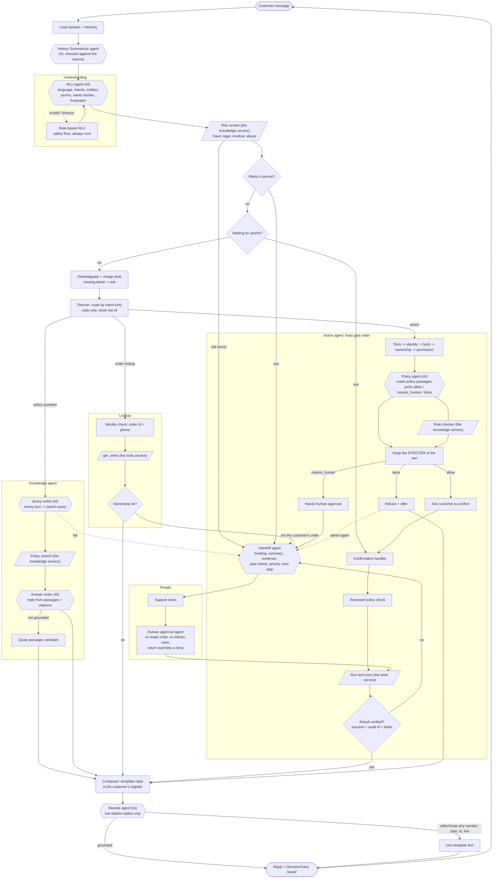
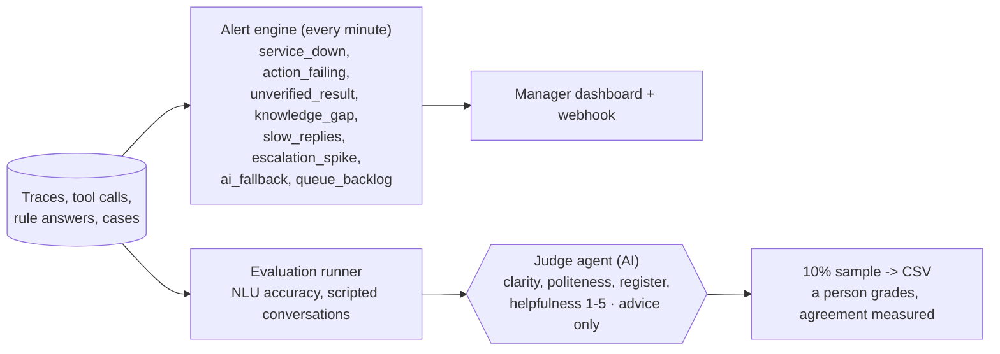

# The agent: the agentic system

Rule that holds everywhere: **the AI model proposes, code decides.** Every AI agent below has a rule-based or template fallback, and its output is checked by code before it is used. The AI can raise a safety flag or send a case to a person; it can never clear a flag, choose a tool, or turn a "deny" into an "allow".

## 1. Workflow of one customer message

Legend: `{{ }}` AI agent, `[/ /]` outside service (the knowledge service / the tools service), `[ ]` deterministic code.

## 2. Who watches the agents (outside the message loop)

## 3. The agents

| Agent | Type | Job | Guard rail / fallback | Code |
|---|---|---|---|---|
| **NLU agent** | AI + rules | Reads language, intents, entities, yes/no, wants-human, frustration | Rules run first as a floor; AI drops unknown intents, can't invent ids/phones, can raise but not clear flags; one JSON repair, then `rules_fallback` | `understanding/ai_reader.py`, `understanding/rules.py` |
| **History summarizer** | AI + template | Summarizes older messages that no longer fit in memory | Rejected if it holds a number, id or date not in the source; template summary used instead | `replies/summarizer.py` |
| **Knowledge agent** | AI (2 steps) | Writes the search query, then words the answer from retrieved passages | Answer must pass `check_grounded` and cite only retrieved passages; else verbatim quote. Empty twice -> `no_evidence` handoff | `knowledge/ai_steps.py`, `knowledge/answers.py` |
| **Policy agent** | AI + rule checker | Reads policy for a state-changing action and picks allow / require_human / deny | Stricter of AI and rule checker wins; AI can never turn deny/require_human into allow; AI or search down -> a person decides | `adapters/llm_policy_gate.py` |
| **Action agent** | Code | Runs the fixed gate order and calls the tool once, then verifies the result | Writes never retried; unverified outcome -> handoff | `actions/flow.py`, `actions/permissions.py` |
| **Rewrite agent** | AI + template | Makes low-stakes replies sound natural | Never for confirmations, results, refusals; any new/dropped number, date, id, link or citation -> template used | `replies/rewrite.py` |
| **Handoff agent** | Code (+ AI summary) | Builds the briefing for the human: summary, evidence, past tickets, priority, next step | Briefing completeness check on every case | `handoff/cases.py` |
| **Human approval** | Code | Applies a person's approve / reject | Re-reads the order, re-checks rules with the approval; a deny stays a deny; once only | `actions/approval.py` |
| **Alert engine** | Code | Opens and resolves manager alerts from counts, never message text | One open alert per rule+key | `monitoring/alerts.py` |
| **Judge agent** | AI | Scores reply quality for the evaluation report | Advice only; 10% sampled for human grading | `judge.py` |

Outside services: **The knowledge service** supplies policy search, the rule checker and the risk screen. **The tools service** supplies the shop tools (`get_order`, returns, refunds, tickets). In `AGENT_BACKENDS=live` these are real HTTP calls; otherwise the agent uses its own simulated services.
